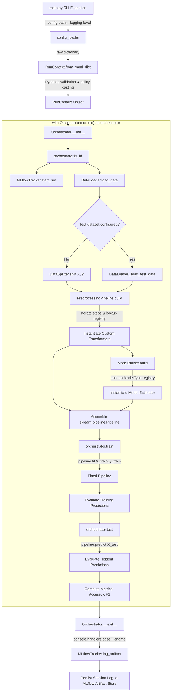
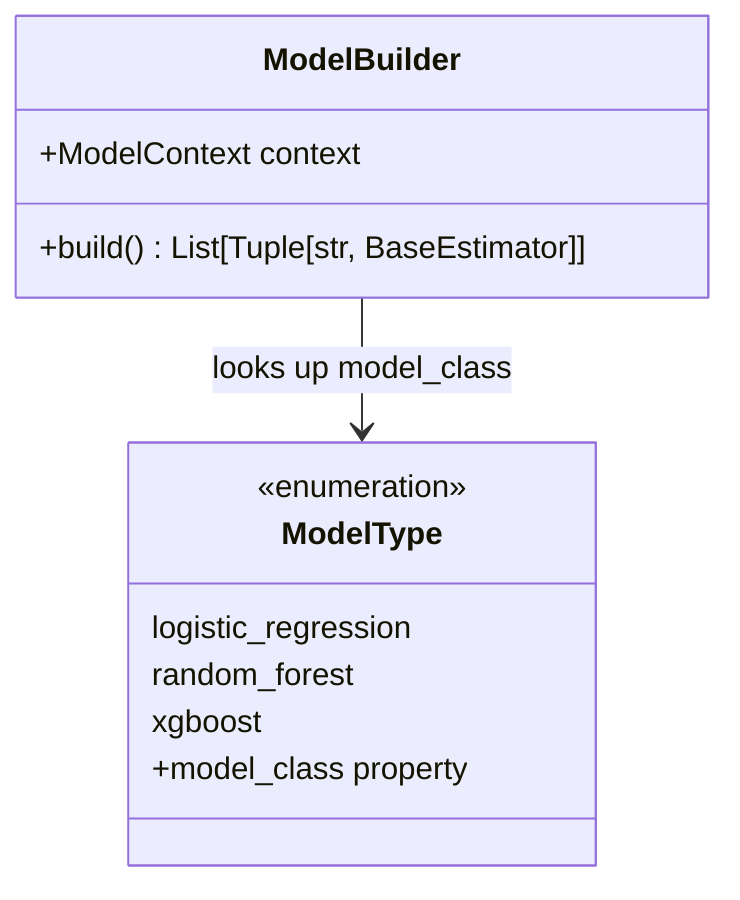

# mlflow-experience

> **A declarative, configuration-driven MLOps pipeline platform built on Scikit-Learn, Pydantic, and MLflow.**

[](https://www.python.org/)
[](https://scikit-learn.org/)
[](https://mlflow.org/)
[](https://docs.pydantic.dev/)
[](https://www.docker.com/)
[](https://sid-146.github.io/mlflow-experience/)

> 📖 **Full Documentation Website**: [https://sid-146.github.io/mlflow-experience/](https://sid-146.github.io/mlflow-experience/)

---

## Table of Contents

1. [Executive Overview](#executive-overview)
2. [Key Capabilities & Philosophy](#key-capabilities--philosophy)
3. [System Architecture](#system-architecture)
    - [Architectural Layers](#architectural-layers)
    - [End-to-End Execution Flowchart](#end-to-end-execution-flowchart)
4. [Repository Structure](#repository-structure)
5. [Configuration Specification (YAML Schema)](#configuration-specification-yaml-schema)
    - [Schema Breakdown](#schema-breakdown)
    - [Example Configurations](#example-configurations)
6. [Data Ingestion & Splitting Engine](#data-ingestion--splitting-engine)
7. [Preprocessing Engine & Transformers](#preprocessing-engine--transformers)
    - [DataFrame Preservation](#dataframe-preservation)
    - [Transformer Suite](#transformer-suite)
    - [Policy Enforcement & Dynamic ColumnTransformer](#policy-enforcement--dynamic-columntransformer)
8. [Model Building & Estimator Factory](#model-building--estimator-factory)
9. [Observability & Tracking Engine](#observability--tracking-engine)
    - [MLflow Experiment Tracker](#mlflow-experiment-tracker)
    - [Dual Logging Subsystem](#dual-logging-subsystem)
    - [Artifact Serialization](#artifact-serialization)
10. [Infrastructure & Environment Setup](#infrastructure--environment-setup)
    - [Prerequisites](#prerequisites)
    - [Virtual Environment Setup](#virtual-environment-setup)
    - [Docker Compose MLflow Stack](#docker-compose-mlflow-stack)
11. [Running Experiments](#running-experiments)
    - [CLI Usage](#cli-usage)
    - [Log Output Inspection](#log-output-inspection)
12. [Developer Guide: Extending the Platform](#developer-guide-extending-the-platform)
    - [Adding a New Preprocessing Transformer](#adding-a-new-preprocessing-transformer)
    - [Adding a New Model Estimator](#adding-a-new-model-estimator)
    - [Adding a New Data Source Handler](#adding-a-new-data-source-handler)
13. [Architecture Evolution & Roadmap](#architecture-evolution--roadmap)
    - [Transition from Linear Pipeline to DAG Engine](#transition-from-linear-pipeline-to-dag-engine)
    - [Nested MLflow Runs & Automatic Node Decorators](#nested-mlflow-runs--automatic-node-decorators)
    - [Feature Engineering Factory](#feature-engineering-factory)

---

## Executive Overview

`mlflow-experience` is an enterprise-grade, configuration-driven Machine Learning Operations (MLOps) framework designed to automate the lifecycle of training, evaluating, and tracking predictive models.

In traditional machine learning workflows, experimentation often suffers from:

- **Code Duplication**: Preprocessing, data cleaning, and model instantiations are hardcoded across disparate scripts and notebooks.
- **Data Leakage**: Preprocessing transformations (scaling, imputations, encoding) inadvertently learn parameters across both training and testing datasets.
- **Traceability Gaps**: Parameters, hyperparameters, runtime logs, and output models are inconsistently tracked or separated from experiment code.

`mlflow-experience` resolves these challenges by decoupling **experiment definition** from **execution logic**. Users specify datasets, schema normalization, missing value policies, categorical encodings, feature scaling, model architectures, and evaluation metrics entirely in structured **YAML** files. The core `Orchestrator` compiles this declarative specification into a validated, strongly-typed `RunContext` (powered by Pydantic v2), builds a cohesive `sklearn.pipeline.Pipeline`, trains the model while preventing data leakage, calculates evaluation metrics, and logs metadata and runtime artifacts directly to **MLflow**.

---

## Key Capabilities & Philosophy

- **Zero-Code Experimentation**: Configure new models, alter hyperparameters, change imputation strategies, or test feature scalers without altering Python code.
- **Strict Separation of Concerns (SoC)**: Granular modules handle data ingestion (`DataLoader`), data splitting (`DataSplitter`), data transformation (`PreprocessingPipeline`), model instantiation (`ModelBuilder`), and observability (`MLflowTracker`).
- **Strict Type Validation via Pydantic v2**: Every configuration key is validated against strongly typed policies with custom validators, failing fast before costly compute cycles start.
- **DataFrame Integrity Throughout**: Sklearn pipelines natively emit Pandas DataFrames (`set_config(transform_output="pandas")`), retaining column names and relational context across sequential stages.
- **Leakage Prevention by Design**: Transformers compute state (means, medians, categories) solely during `fit()` on the training split, and apply the learned state deterministically during `transform()` on evaluation data.
- **Centralized Observability**: Automatic capture of console logs, model artifacts, metrics, and parameters into a self-hosted MLflow tracking stack backed by PostgreSQL and MinIO S3 object storage.

---

## System Architecture

The framework is architected using the **Command/Orchestrator Pattern** to coordinate runtime workflows and the **Factory Pattern** to dynamically construct transformers and model estimators.

### Architectural Layers

```
┌────────────────────────────────────────────────────────────────────────┐
│ Layer 5: Orchestration & Execution (The Conductor)                     │
│ Orchestrator context manager: build() -> train() -> test() -> exit()   │
└──────────────────────────────────┬─────────────────────────────────────┘
                                   │ coordinates
┌──────────────────────────────────▼─────────────────────────────────────┐
│ Layer 4: Transformation & ML Logic (The Engine)                        │
│ PreprocessingPipeline (Transformers) + ModelBuilder (Estimator)        │
└──────────────────────────────────┬─────────────────────────────────────┘
                                   │ operates on
┌──────────────────────────────────▼─────────────────────────────────────┐
│ Layer 3: Data Management & Ingestion (The I/O Layer)                   │
│ DataLoader (CSV, Excel, JSON) + DataSplitter (train_test_split)        │
└──────────────────────────────────┬─────────────────────────────────────┘
                                   │ consumes
┌──────────────────────────────────▼─────────────────────────────────────┐
│ Layer 2: Configuration & Validation (The Brain)                        │
│ config_loader (YAML) -> RunContext & Pydantic Policies                 │
└──────────────────────────────────┬─────────────────────────────────────┘
                                   │ instrumented with
┌──────────────────────────────────▼─────────────────────────────────────┐
│ Layer 1: Infrastructure & Observability (The Foundation)               │
│ MLflowTracker (Runs, Params, Metrics, Artifacts) + Colored Logger      │
└────────────────────────────────────────────────────────────────────────┘
```

1. **Layer 1: Infrastructure & Observability**: Manages active run sessions, sets tracking URIs, creates or connects to MLflow experiments, logs parameters, metrics, models, and ships runtime log files upon context manager exit.
2. **Layer 2: Configuration & Validation**: Parses input YAML files and enforces schema integrity through Pydantic models (`ProjectContext`, `MlFlowContext`, `DataContext`, `PreprocessingContext`, `ModelContext`, `TrainingContext`, `EvaluationContext`). Dynamically casts raw step parameters into specialized policy classes (`RenamePolicy`, `TypeCastPolicy`, `MissingValuePolicy`, `EncodingPolicy`, `ScalingPolicy`).
3. **Layer 3: Data Management & Ingestion**: Abstracted data loading supporting path resolution (relative, working directory, repository root), file format dispatching, and deterministic train/test splitting.
4. **Layer 4: Transformation & ML Logic**: Dynamically builds Sklearn-compliant transformers (`RenameColumnsTransformer`, `MissingValueTransformer`, `CleaningTransformer`, `FilterTransformer`, `ScalingTransformer`, `EncodingTransformer`) and combines them with model estimators (`LogisticRegression`, `XGBClassifier`) into an executable `sklearn.pipeline.Pipeline`.
5. **Layer 5: Orchestration & Execution**: The `Orchestrator` implements Python's context manager protocol (`__enter__` / `__exit__`), orchestrating the sequence of building components, fitting the pipeline on training data, evaluating predictions on holdout splits, and automatically persisting artifacts.

---

### End-to-End Execution Flowchart



---

## Repository Structure

```text
mlflow-experience/
├── .env                              # Environment variables for Docker services (Postgres, MinIO, MLflow)
├── .flake8                           # Flake8 linter configuration
├── .gitignore                        # Git ignore patterns
├── compose.yaml                      # Docker Compose stack for MLflow, PostgreSQL, and MinIO
├── Dockerfile                        # Container definition for containerized pipeline execution
├── init-db.sql                       # Database initialization script for PostgreSQL MLflow backend
├── main.py                           # Application entrypoint with CLI argument parser
├── README.md                         # Project documentation and architectural manual
├── requirements.txt                  # Pinned Python package dependencies
├── Todo.md                           # Development backlog and task tracking
├── AGENTS.md                         # Operational instructions and invariants for AI coding agents
├── FUTURE_ENHANCEMENTS.md            # Comprehensive future scenarios & evolutionary roadmap
│
├── configs/                          # Declarative YAML experiment configuration files
│   ├── demo.yaml                     # Production-style experiment schema specification
│   ├── mvp.yaml                      # Working MVP configuration (Logistic Regression on Churn)
│   ├── mvp_xgboost.yaml              # Working MVP configuration (XGBoost Classifier on Churn)
│   └── preprocessing.yaml            # Exhaustive schema definition for advanced preprocessing
│
├── data/                             # Dataset storage
│   └── raw/                          # Raw tabular datasets
│       ├── churn_train.csv           # Telecom churn training dataset
│       ├── churn_test.csv            # Telecom churn holdout test dataset
│       ├── train.csv                 # Alternative tabular training dataset
│       └── test.csv                  # Alternative tabular testing dataset
│
└── src/                              # Source code package
    ├── __init__.py                   # Package initializer
    ├── orchestrator.py               # Orchestrator class managing pipeline lifecycle
    │
    ├── core/                         # Core system framework
    │   ├── __init__.py               # Exports RunContext
    │   ├── constants/                # Type definitions and lookup registries
    │   │   ├── constants.py          # Type literals (FILE_TYPES, MISSING_STRATEGY, etc.)
    │   │   └── registry.py           # PreprocessingRegistry, ModelType, DATA_READER_FUNCTIONS
    │   ├── context/                  # Pydantic configuration schemas and policies
    │   │   ├── contexts.py           # RunContext and sub-contexts (Project, MlFlow, Data, etc.)
    │   │   └── policies.py           # Strongly-typed column policies (Rename, Missing, Encoding, Scaling)
    │   ├── errors/                   # Custom application exceptions
    │   │   └── handler_errors.py     # LoaderError and handler error definitions
    │   ├── handler/                  # I/O and data manipulation handlers
    │   │   ├── config/
    │   │   │   └── loader.py         # YAML file parser (safe_load)
    │   │   └── data/
    │   │       ├── loader.py         # DataLoader with multi-format reading & path resolution
    │   │       └── splitter.py       # DataSplitter wrapping train_test_split
    │   ├── logging/                  # Logging infrastructure
    │   │   └── logger.py             # Dual console/file logger with ANSI color formatting
    │   ├── logs/                     # Auto-created directory storing timestamped log files
    │   ├── models/                   # Standalone model factory helpers
    │   │   └── linear.py             # Linear regression model constructor
    │   ├── pipelines/                # Pipeline assembly and transformation components
    │   │   ├── evaluation.py         # Model evaluation helper class
    │   │   ├── features.py           # Feature engineering placeholder
    │   │   ├── model_builder.py      # Estimator factory instantiating models from ModelContext
    │   │   ├── pipeline.py           # Base abstract pipeline class
    │   │   ├── preprocessing.py      # PreprocessingPipeline assembling transformer instances
    │   │   └── transformers.py       # Custom Scikit-Learn transformers (Missing, Scaling, Encoding, etc.)
    │   └── trackers/                 # Experiment tracking integrations
    │       └── mlflow_tracker.py     # MLflowTracker client wrapper
    │
    └── utils/                        # Utility scripts
        └── data_loader.py            # Auxiliary data loader utilities
```

---

## Configuration Specification (YAML Schema)

The framework is completely steered through YAML configuration files. The configuration is parsed by `config_loader` and validated using Pydantic's `RunContext`.

### Schema Breakdown

| Section         | Required | Key Attributes                                                                                | Description                                                                                        |
| :-------------- | :------- | :-------------------------------------------------------------------------------------------- | :------------------------------------------------------------------------------------------------- |
| `project`       | Yes      | `name`, `owner`, `environment`, `description`                                                 | High-level project metadata and audit attributes.                                                  |
| `mlflow`        | Yes      | `experiment_name`, `tracking_uri`, `track_params`, `track_metrics`, `track_artifacts`, `tags` | Observability configuration for MLflow tracking server connection and tagging.                     |
| `dataset`       | Yes      | `dataset_name`, `random_state`, `train_test_split`, `train`, `test`                           | Ingestion directives. `train` and `test` each define `type`, `path`, `id_column`, `target_column`. |
| `preprocessing` | Yes      | List of steps: `name`, `type`, `params`                                                       | Sequential data preparation steps mapped to `PreprocessingRegistry`.                               |
| `model`         | Yes      | `type`, `task`, `hyperparameters`                                                             | Model family (e.g., `logistic_regression`, `xgboost`), task type, and hyperparameter mapping.      |
| `training`      | Yes      | `objective`                                                                                   | Training objective (e.g., `binary:logistic`).                                                      |
| `evaluation`    | Yes      | `metrics`                                                                                     | Target evaluation metrics to compute (e.g., `accuracy`, `f1`).                                     |

---

### Example Configurations

#### 1. Logistic Regression Baseline (`configs/mvp.yaml`)

```yaml
project:
    name: customer_churn_prediction
    owner: data_science_team
    environment: production
    description: Predict customer churn for telecom users

mlflow:
    experiment_name: customer_churn_experiments
    experiment_id: NA
    tracking_uri: http://localhost:5000
    track_params: true
    track_metrics: true
    track_artifacts:
        - feature_config
        - preprocessing_objects
        - model
    tags:
        project: churn
        stage: production
        owner: data_science_team

dataset:
    dataset_name: telecom_churn_v1
    random_state: 52
    train_test_split: 0.2
    train:
        type: csv
        path: data/raw/churn_train.csv
        id_column: CustomerID
        target_column: Churn
        positive_class: 1

preprocessing:
    # Step 1: Rename columns for standardization
    - name: rename_columns
      type: rename
      params:
          mapping:
              CustomerID: customer_id
              Usage Frequency: usage_frequency
              Support Calls: support_calls
              Payment Delay: payment_delay
              Subscription Type: subscription_type
              Contract Length: contract_length
              Total Spend: total_spend
              Last Interaction: last_interaction

    # Step 2: Type cast specific columns
    - name: cast_types
      type: type_cast
      params:
          columns:
              - name: Age
                dtype: int
              - name: Gender
                dtype: str
              - name: Tenure
                dtype: int

    # Step 3: Impute missing values with column-specific strategies
    - name: handle_missing
      type: missing
      params:
          columns:
              - name: Age
                strategy: mean
              - name: Gender
                strategy: mode

    # Step 4: Categorical feature encoding
    - name: encode_features
      type: encoding
      params:
          columns:
              - name: Gender
                strategy: ordinal
                order: ["Male", "Female"]
              - name: contract_length
                strategy: ordinal
                order: ["Monthly", "Quarterly", "Annual"]
              - name: subscription_type
                strategy: one_hot

    # Step 5: Feature scaling
    - name: scale_features
      type: scaling
      params:
          columns:
              - name: Age
                strategy: standard
              - name: total_spend
                strategy: minmax

model:
    type: logistic_regression
    task: "binary:classification"
    hyperparameters:
        C: 1.0
        max_iter: 250
        solver: saga

training:
    objective: binary:logistic

evaluation:
    metrics:
        - accuracy
        - f1
```

#### 2. XGBoost Classifier Pipeline (`configs/mvp_xgboost.yaml`)

```yaml
# Inherits same project, mlflow, dataset, and preprocessing structure as above...
model:
    type: xgboost
    task: "xgboost:classification"
    hyperparameters:
        n_estimators: 1000
        learning_rate: 0.001
        max_depth: 10
        random_state: 42

training:
    objective: xgboost:binary:classification

evaluation:
    metrics:
        - accuracy
        - f1
```

---

## Data Ingestion & Splitting Engine

The data ingestion layer is decoupled from Scikit-Learn logic to keep data acquisition clean and testable.

### Path Resolution

`DataLoader._resolve_path(path: str)` dynamically discovers datasets regardless of the process working directory:

1. Returns the path directly if it is already absolute.
2. Checks relative to the current working directory (`os.getcwd()`).
3. Checks relative to the repository root by inspecting parent paths.

### Multi-Format Reader

The `DATA_READER_FUNCTIONS` registry maps file types to Pandas readers:

- `csv` $\to$ `pd.read_csv`
- `excel` / `xlsx` $\to$ `pd.read_excel`
- `json` $\to$ `pd.read_json`

### Leakage-Free Splitting

When an explicit `test` dataset is absent from the configuration, `DataSplitter.split(X, y)` applies `sklearn.model_selection.train_test_split` using the user's `train_test_split` ratio (defaulting to 0.2) and fixed `random_state`. Feature matrices $X$ and target vectors $y$ are partitioned prior to any pipeline compilation.

---

## Preprocessing Engine & Transformers

The transformation layer wraps custom and Scikit-Learn native transformers into a unified pipeline.

### DataFrame Preservation

Standard Scikit-Learn transformers convert tabular Pandas DataFrames into NumPy arrays, discarding column names and making downstream debugging difficult. `mlflow-experience` fixes this globally:

```python
from sklearn import set_config

set_config(transform_output="pandas")
```

All custom transformers inherit from `BaseEstimator` and `TransformerMixin`, returning Pandas DataFrames across every stage.

### Transformer Suite

#### 1. `RenameColumnsTransformer`

- **Purpose**: Normalizes raw column headers (e.g., stripping spaces, changing casing).
- **Behavior**: Calls `X.rename(columns=self.mapping)`.

#### 2. `MissingValueTransformer`

- **Purpose**: Column-specific missing value imputation.
- **Strategies Supported**:
    - `mean`: Imputes missing numeric values with the column mean.
    - `median`: Imputes missing numeric values with the column median.
    - `mode`: Imputes missing categorical values with the most frequent value (`.mode().iloc[0]`).
    - `constant`: Imputes missing values with a user-supplied constant (`fill_value`).
- **State Learning**: Imputation values are computed strictly inside `fit(X)` and stored in `self.fill_values`. `transform(X)` applies `X.fillna(self.fill_values)`.

#### 3. `CleaningTransformer`

- **Purpose**: Categorical string replacements and domain-level value cleaning.
- **Behavior**: Executes dictionary mappings across specified columns (`X[col].replace(mapping)`).

#### 4. `FilterTransformer`

- **Purpose**: Row-level filtering based on logical expressions (e.g., `tenure > 0`).
- **Behavior**: Calls `X.query(self.condition)`. _(Note: Row drops are applied during initial cleaning; using row-filtering inside estimator pipelines must be managed with care to maintain target alignment)._

#### 5. `ScalingTransformer`

- **Purpose**: Applies distinct scaling algorithms to subsets of numerical features simultaneously.
- **Strategies Supported**:
    - `standard` $\to$ `StandardScaler()`
    - `minmax` $\to$ `MinMaxScaler()`
    - `robust` $\to$ `RobustScaler()`
- **Architecture**: Groups columns by requested strategy and compiles a Scikit-Learn `ColumnTransformer(transformers=..., remainder="passthrough")`.

#### 6. `EncodingTransformer`

- **Purpose**: Converts categorical variables into numerical vectors.
- **Strategies Supported**:
    - `one_hot` $\to$ `OneHotEncoder(handle_unknown="ignore", sparse_output=False)`
    - `ordinal` $\to$ `OrdinalEncoder(categories=...)`
- **Architecture**: Dynamically groups columns by strategy and compiles a `ColumnTransformer` with `remainder="passthrough"`.

---

## Model Building & Estimator Factory

The `ModelBuilder` class instantiates the final estimator step of the pipeline.



- **Registry Lookup**: Models are defined in `ModelType` (`src/core/constants/registry.py`).
    - `logistic_regression` $\to$ `sklearn.linear_model.LogisticRegression`
    - `xgboost` $\to$ `xgboost.XGBClassifier`
    - `random_forest` $\to$ `sklearn.ensemble.RandomForestClassifier` (plug-in ready)
- **Hyperparameter Injection**: The `hyperparameters` dictionary defined in the YAML file is unpacked directly into the estimator constructor: `model_class(**hp)`.
- **Pipeline Step Output**: Returns a tuple `[(task_name, model_instance)]` that is appended as the terminal step in the Scikit-Learn `Pipeline`.

---

## Observability & Tracking Engine

### MLflow Experiment Tracker

The `MLflowTracker` (`src/core/trackers/mlflow_tracker.py`) wraps MLflow client interactions:

- **Automatic Experiment Provisioning**: Checks if `experiment_name` exists on the tracking server; creates it if absent.
- **Tracking URI Resolution**: Configured via YAML (`mlflow.tracking_uri`) or falls back to `http://localhost:5000`.
- **Run Lifecycle**: `start_run()` initiates the active MLflow run, capturing Git commit hashes, environment attributes, and custom tags.

### Dual Logging Subsystem

The framework provides an enterprise logging engine (`src/core/logging/logger.py`):

1. **Console StreamHandler**: Formatted with `ColoredFormatter` to output ANSI-color-coded levels (DEBUG in Blue, INFO in Green, WARNING in Yellow, ERROR in Red, CRITICAL in Magenta).
2. **FileHandler**: Automatically writes all log lines to timestamped files:
   `src/core/logs/logs_%Y_%m_%d_%H_%M.log`

### Artifact Serialization

Upon pipeline completion or termination, the `Orchestrator.__exit__` context manager automatically transfers the session log file to the MLflow artifact repository:

```python
def __exit__(self, exc_type, exc, tb):
    self.mlflow_tracker.log_artifact(
        console.handlers[1].baseFilename,
        f"logs/{self.mlflow_tracker.run.info.run_name}.log",
    )
```

---

## Infrastructure & Environment Setup

### Prerequisites

- **Python**: Version 3.11 or 3.12 installed.
- **Docker & Docker Compose**: Installed and running (for local MLflow, PostgreSQL, and MinIO storage).

### Environment Setup with uv (Recommended)

1. **Clone the repository:**
    ```bash
    git clone https://github.com/your-org/mlflow-experience.git
    cd mlflow-experience
    ```

2. **Synchronize environment using uv:**
    ```bash
    # Automatically creates .venv and installs all dependencies from uv.lock
    uv sync
    ```

    *Legacy pip fallback:*
    ```bash
    python -m venv .venv
    .\.venv\Scripts\Activate.ps1  # Windows (or source .venv/bin/activate on Linux)
    pip install -r requirements.txt
    ```

---

### Docker Compose MLflow Stack

The repository includes a production-grade MLflow tracking server setup in `compose.yaml`:

```
┌────────────────────────────────────────────────────────┐
│                   Docker Compose Stack                 │
│                                                        │
│  ┌─────────────────┐             ┌──────────────────┐  │
│  │  PostgreSQL 16  │             │   MinIO Storage  │  │
│  │  (Backend DB)   │             │  (S3 Artifacts)  │  │
│  └────────┬────────┘             └────────┬─────────┘  │
│           │                               │            │
│           └──────────────┬────────────────┘            │
│                          │                             │
│                 ┌────────▼─────────┐                   │
│                 │   MLflow Server  │ (Port 5000)       │
│                 └──────────────────┘                   │
└────────────────────────────────────────────────────────┘
```

1. **Review Environment Settings (`.env`):**

    ```env
    POSTGRES_DB=mlflowdb
    POSTGRES_USER=mlflow
    POSTGRES_PASSWORD=mlflowpass

    MINIO_ROOT_USER=minioadmin
    MINIO_ROOT_PASSWORD=minioadminpass

    MLFLOW_HOST=0.0.0.0
    MLFLOW_PORT=5000
    ```

2. **Start the Infrastructure:**

    ```bash
    docker compose up -d
    ```

3. **Access Services:**
    - **MLflow Tracking UI**: [http://localhost:5000](http://localhost:5000)
    - **MinIO Web Console**: [http://localhost:9001](http://localhost:9001)

---

## Running Experiments

### CLI Usage

Execute runs from the project root using `main.py`:

```bash
# Run baseline Logistic Regression experiment with DEBUG output
python -m main --config configs/mvp.yaml --logging-level DEBUG

# Run XGBoost experiment with standard INFO output
python -m main --config configs/mvp_xgboost.yaml --logging-level INFO
```

#### CLI Parameters

- `--config` (_str_, required): Relative or absolute path to the experiment YAML file.
- `--logging-level` (_str_, optional, default: `"INFO"`): Console logging verbosity (`DEBUG`, `INFO`, `WARNING`, `ERROR`).

---

### Log Output Inspection

When running an experiment, the console displays colorized status messages:

```text
DEBUG: 2026-10-14 23:28:15 : main.py : [run] : 11 : Reading data from config
INFO : 2026-10-14 23:28:15 : orchestrator.py : [build] : 52 : Starting pipeline build for model : customer_churn_experiments
DEBUG: 2026-10-14 23:28:15 : loader.py : [_load_train_data] : 78 : Training dataset shape : (400000, 11)
INFO : 2026-10-14 23:28:15 : orchestrator.py : [build] : 71 : No test dataset provided, proceeding with train-test split.
INFO : 2026-10-14 23:28:16 : orchestrator.py : [build] : 82 : Building preprocessing pipeline...
INFO : 2026-10-14 23:28:16 : orchestrator.py : [build] : 102 : Pipeline instance created. Pipeline ready for training and testing...
INFO : 2026-10-14 23:28:18 : orchestrator.py : [train] : 121 : Training completed, pipeline fitted with training dataset.
INFO : 2026-10-14 23:28:18 : orchestrator.py : [evaluate] : 146 : --- Starting Evaluation (on provided dataset) ---
INFO : 2026-10-14 23:28:18 : orchestrator.py : [evaluate] : 158 : | Accuracy  : 0.8425
INFO : 2026-10-14 23:28:18 : orchestrator.py : [evaluate] : 158 : | F1 Score  : 0.8110
INFO : 2026-10-14 23:28:18 : orchestrator.py : [evaluate] : 160 : --- Evaluation Complete ---
```

---

## Developer Guide: Extending the Platform

### Adding a New Preprocessing Transformer

To add a new data transformation step (e.g., an Outlier Clipper):

1. **Define the Policy Model (`src/core/context/policies.py`):**

    ```python
    class OutlierConfig(ColumnConfig):
        method: Literal["clip", "zscore"]
        lower_quantile: Optional[float] = 0.01
        upper_quantile: Optional[float] = 0.99


    class OutlierPolicy(BaseModel):
        columns: List[OutlierConfig]
    ```

2. **Implement the Scikit-Learn Transformer (`src/core/pipelines/transformers.py`):**

    ```python
    class OutlierTransformer(BaseEstimator, TransformerMixin):
        def __init__(self, params=None):
            self.params = params
            self.bounds_ = {}

        def fit(self, X, y=None):
            if hasattr(self.params, "columns"):
                for col in self.params.columns:
                    lower = X[col.name].quantile(col.lower_quantile)
                    upper = X[col.name].quantile(col.upper_quantile)
                    self.bounds_[col.name] = (lower, upper)
            return self

        def transform(self, X):
            X = X.copy()
            for col, (lower, upper) in self.bounds_.items():
                X[col] = X[col].clip(lower=lower, upper=upper)
            return X
    ```

3. **Register the Step (`src/core/constants/registry.py`):**

    ```python
    class PreprocessingRegistry(str, Enum):
        # ... existing entries ...
        outliers = "outliers"

        @property
        def policy_class(self):
            # map PreprocessingRegistry.outliers -> OutlierPolicy
            ...

        @property
        def transformer_class(self):
            # map PreprocessingRegistry.outliers -> OutlierTransformer
            ...
    ```

4. **Use in YAML Config:**
    ```yaml
    preprocessing:
        - name: clip_outliers
          type: outliers
          params:
              columns:
                  - name: total_spend
                    method: clip
                    lower_quantile: 0.01
                    upper_quantile: 0.99
    ```

---

### Adding a New Model Estimator

1. **Update `ModelType` Enum (`src/core/constants/registry.py`):**

    ```python
    from sklearn.ensemble import RandomForestClassifier


    class ModelType(str, Enum):
        logistic_regression = "logistic_regression"
        xgboost = "xgboost"
        random_forest = "random_forest"

        @property
        def model_class(self):
            mapping = {
                ModelType.logistic_regression: LogisticRegression,
                ModelType.xgboost: XGBClassifier,
                ModelType.random_forest: RandomForestClassifier,
            }
            return mapping.get(self)
    ```

2. **Configure in YAML:**
    ```yaml
    model:
        type: random_forest
        task: "random_forest:classification"
        hyperparameters:
            n_estimators: 200
            max_depth: 12
            random_state: 42
    ```

---

### Adding a New Data Source Handler

To support Apache Parquet or SQL databases:

1. **Add File Type (`src/core/constants/constants.py`):**

    ```python
    FILE_TYPES = Literal["csv", "parquet", "excel", "xlsx", "sql"]
    ```

2. **Register Reader Function (`src/core/constants/registry.py` & `src/core/handler/data/loader.py`):**
    ```python
    DATA_READER_FUNCTIONS = {
        "csv": pd.read_csv,
        "parquet": pd.read_parquet,
        "excel": pd.read_excel,
        "json": pd.read_json,
    }
    ```

---

## Architecture Evolution & Roadmap

> [!TIP]
> For an in-depth breakdown of 8 future architectural scenarios, proposed YAML schemas, and phased milestones, see the dedicated [Future Enhancements Guide](FUTURE_ENHANCEMENTS.md).

### Transition from Linear Pipeline to DAG Engine

_Current Limitation_: Linear Scikit-Learn pipelines execute strictly sequentially ($Step_1 \to Step_2 \to Step_3$). Complex ML pipelines often require branching (e.g., parallel text, numerical, and categorical feature paths) and joins.

_Target Solution_: Implement a Directed Acyclic Graph (DAG) executor:

- Define nodes with explicit dependencies (`depends_on: [step_a, step_b]`).
- Execute via **Topological Sorting** (Kahn's algorithm or DFS).
- Merge multi-branch outputs using specialized join transformers.

```
       ┌───────────────┐
       │ Ingestion/Raw │
       └───────┬───────┘
               │
       ┌───────▼───────┐
       │ Clean & Impute│
       └───────┬───────┘
         ┌─────┴─────┐
         │           │
 ┌───────▼──────┐ ┌──▼────────────┐
 │ Scaled Numerics│ │ Categorical Enc│
 └───────┬──────┘ └──┬────────────┘
         │           │
         └─────┬─────┘
       ┌───────▼───────┐
       │ Column Merge  │
       └───────┬───────┘
       ┌───────▼───────┐
       │   Estimator   │
       └───────────────┘
```

---

### Nested MLflow Runs & Automatic Node Decorators

_Target Solution_: Transition from single-run tracking to hierarchical nested runs in MLflow:

- **Parent Run**: Encompasses the entire pipeline invocation.
- **Child Run per Node**: Automatically logs step runtime, intermediate row counts, memory footprints, and transformation parameters using a `@track_node` decorator:

```python
def track_node(tracker):
    def decorator(func):
        @wraps(func)
        def wrapper(self, X, *args, **kwargs):
            tracker.start_run(run_name=self.__class__.__name__)
            tracker.log_metric("input_rows", X.shape[0])
            tracker.log_metric("input_cols", X.shape[1])
            output = func(self, X, *args, **kwargs)
            tracker.log_metric("output_rows", output.shape[0])
            tracker.end_run()
            return output

        return wrapper

    return decorator
```

---

### Feature Engineering Factory

_Target Solution_: Formalize a modular Feature Engineering engine (`src/core/pipelines/features.py`) supporting:

- **Aggregations**: Group-level statistics (mean, variance, count, min/max).
- **Interactions**: Multiplicative, ratio, and polynomial feature generation.
- **Temporal Transformations**: Cyclical Sine/Cosine encoding of timestamps, lag features, and rolling window metrics.

---

## License

This project is licensed under the Apache 2.0 License.
