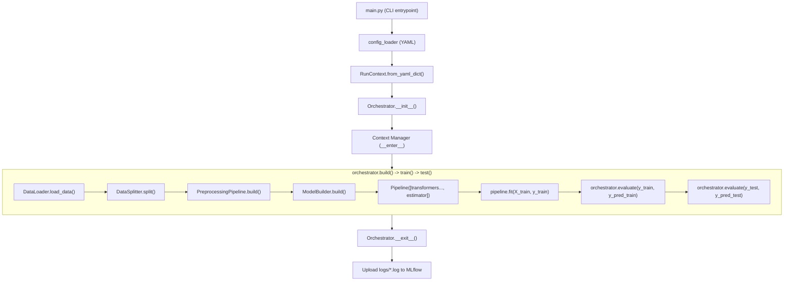
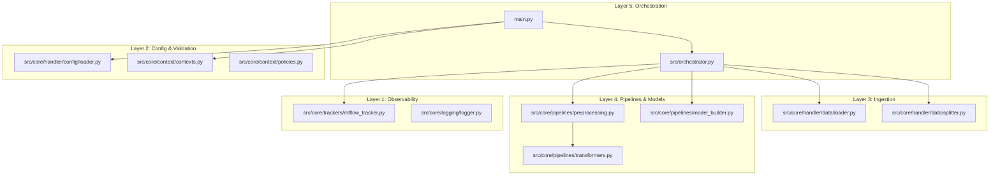
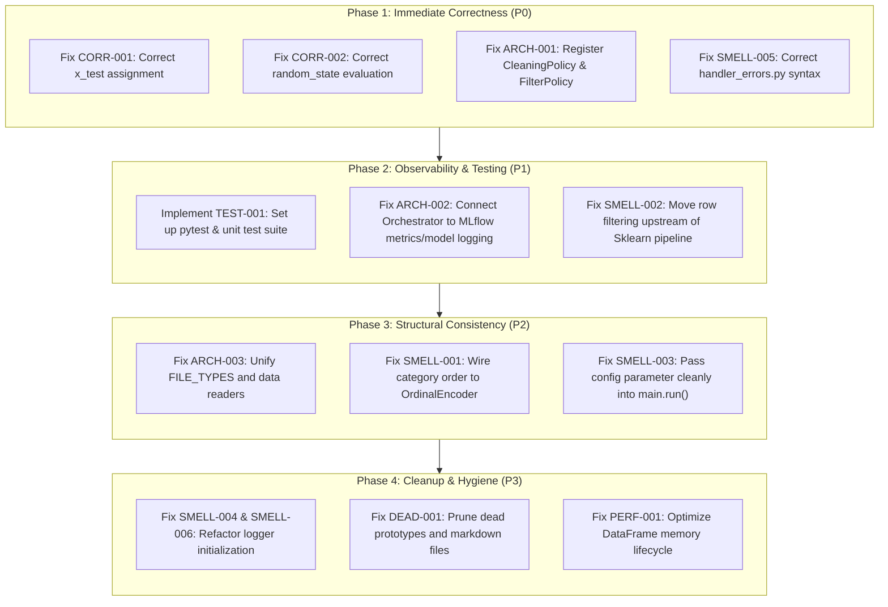

# Codebase Audit: Complexity, Code Smells & Maintainability

**Audit Date:** October 2026  
**Auditor:** Staff+ Software Engineer  
**Repository:** `sid-146/mlflow-experience`  
**Target:** Full Repository Architecture, Code Quality, Observability & Reliability  
**Artifact Path:** `docs/CODEBASE_AUDIT.md`

---

## 1. Executive Summary

This codebase audit presents a comprehensive, evidence-based evaluation of **`mlflow-experience`**, a declarative, configuration-driven MLOps pipeline designed to orchestrate tabular data preprocessing, model fitting, and MLflow tracking via YAML specifications.

### Key Takeaways

1. **Compelling Conceptual Foundation with Execution Flaws:**
   The project exhibits a solid architectural philosophy—decoupling pipeline orchestration into 5 logical layers and enforcing schema validation via Pydantic. However, the runtime implementation contains critical correctness bugs, severed contracts between validation and execution, and unfinished prototypes that undermine its declarative promises.

2. **Critical Evaluation Defect (`CORR-001`):**
   In `src/orchestrator.py:78`, the holdout test data references are overwritten with the training set (`self.data_loader.X_test, self.data_loader.y_test = x_train, y_train`). Consequently, all test evaluations are computed on the training set, concealing overfitting and producing invalid validation metrics.

3. **Incomplete MLflow Observability (`ARCH-002`):**
   While marketed as an automated MLflow tracking framework, `Orchestrator` never invokes `mlflow_tracker.log_metrics()`, `mlflow_tracker.log_params()`, `mlflow_tracker.log_model()`, or `mlflow_tracker.end_run()`. It only uploads the plaintext runtime log file upon exit.

4. **Zero Test Coverage (`TEST-001`):**
   The repository contains **no unit, integration, or regression tests**. Neither `pytest` nor any test runner is declared in `requirements.txt` or `pyproject.toml`.

5. **Contract Drift & Dead Features:**
   Pydantic policies accept types (`parquet`, `xlsx`) that crash at runtime in `DataLoader`, while runtime code supports formats (`json`) that Pydantic rejects. Preprocessing steps such as `cleaning` and `filter` crash at initialization because their policy mapping is `None`.

### Findings by Severity & Category

| Category | Critical | High | Medium | Low | Total |
| :--- | :---: | :---: | :---: | :---: | :---: |
| **Correctness & Logic** | 1 | 1 | — | — | **2** |
| **Architecture & Contracts** | 1 | 2 | 1 | — | **4** |
| **Code Smells & Debt** | — | 2 | 2 | 2 | **6** |
| **Testing & Verification** | 1 | — | — | — | **1** |
| **Performance & Resource** | — | — | 1 | — | **1** |
| **Security & Config** | — | — | — | 1 | **1** |
| **Total** | **3** | **5** | **4** | **3** | **15** |

---

## 2. Repository Overview

### Technology Stack & Environment
- **Runtime:** Python `3.12+`
- **Package Manager:** `uv` (`pyproject.toml`, `uv.lock`)
- **Core Libraries:** `scikit-learn>=1.8.0`, `xgboost>=3.4.1`, `pandas>=2.3.3`, `pydantic>=2.12.5`, `mlflow>=3.9.0`, `PyYAML>=6.0.3`
- **Documentation:** MkDocs with Material theme (`mkdocs-material>=9.7.7`)
- **Infrastructure:** Docker Compose stack with PostgreSQL, MinIO, and MLflow Server

### Core Execution Flow



---

## 3. Architecture and Dependency Map

The system is organized into 5 conceptual layers. The table below traces dependencies and boundaries:



### Module Boundary Analysis
- **Tight Coupling to `RunContext`:** Almost every class (`DataLoader`, `DataSplitter`, `PreprocessingPipeline`, `MLflowTracker`, `Orchestrator`) takes the monolithic `RunContext` God Object. Internal components reach deep into nested sub-contexts, violating encapsulation.
- **Missing Boundaries:** `src/core/models/linear.py` contains an abandoned `build_model()` function, while the actual model builder resides in `src/core/pipelines/model_builder.py`.

---

## 4. Complexity Hotspots

### 1. `PreprocessingPipeline._instantiate_transformer()` (`src/core/pipelines/preprocessing.py:16-37`)
- **Nature of Complexity:** Ad-hoc introspection and branching based on attribute presence (`hasattr(params, "mapping")`, `hasattr(params, "columns")`, `hasattr(params, "dict")`).
- **Consequence:** Fragile instantiation logic that fails silently or falls back to empty constructors when new policies do not match hardcoded attribute checks.

### 2. `MissingValueTransformer.fit()` (`src/core/pipelines/transformers.py:54-84`)
- **Nature of Complexity:** Flagged by the author with `# Todo: Improve this function. Too complex`. Nested conditionals handle both policy objects and legacy dictionary structures, applying column-specific aggregations across heterogenous strategies (`mean`, `median`, `mode`, `constant`).
- **Consequence:** High cyclomatic complexity; mixing numeric and categorical data paths without column type guards causes runtime exceptions when `mean` is mistakenly applied to strings.

### 3. `EncodingTransformer.build()` (`src/core/pipelines/transformers.py:210-241`)
- **Nature of Complexity:** Manually collects and groups columns by strategy into dictionaries, attempts to track category ordering in a detached list, and instantiates nested Scikit-Learn `ColumnTransformer` instances.
- **Consequence:** Column order configuration is lost, while unmapped strategies produce warnings but proceed to build partial pipelines.

---

## 5. Code Smells

### 1. Reliance on Global Variable Scope (`main.py:10-12, 35-37`)
`main.py` defines `run(*args, **kwargs)` but accesses the global variable `config` assigned in the `__main__` block:
```python
def run(*args, **kwargs):
    context = RunContext.from_yaml_dict(config)  # 'config' is unresolved in function scope!
...
if __name__ == "__main__":
    config = config_loader(args.config)
    run(**config)
```
**Problem:** `run()` unpacks `**config` into `kwargs`, but completely ignores `kwargs` and accesses `config` from the module global scope. Any programmatic invocation of `run()` from a script or test suite crashes with `NameError: name 'config' is not defined`.

### 2. Fragile Logger Handler Indexing (`src/orchestrator.py:169`)
In `Orchestrator.__exit__`:
```python
self.mlflow_tracker.log_artifact(
    console.handlers[1].baseFilename,
    f"logs/{self.mlflow_tracker.run.info.run_name}.log",
)
```
**Problem:** Direct index access (`handlers[1]`) violates the Law of Demeter. It presumes that `console.handlers` will always have at least two handlers and that index `1` is unconditionally a `FileHandler`. If log configuration changes or a handler is removed, this raises `IndexError` or `AttributeError`.

### 3. Side Effects on Module Import (`src/core/logging/logger.py:40-54`)
Importing `logger.py` executes:
```python
LOG_DIR = os.path.join(BASE_DIR, "logs")
os.makedirs(LOG_DIR, exist_ok=True)
filename = f"logs_{datetime.now().strftime('%Y_%m_%d_%H_%M')}.log"
filepath = os.path.join(LOG_DIR, filename)
f_handler = logging.FileHandler(filepath, mode="a")
```
**Problem:** Merely importing the module creates a new physical file on disk inside `src/core/logs/`. This has polluted the source repository with over 50 timestamped `.log` files.

### 4. Broken Class Definition (`src/core/errors/handler_errors.py:1-2`)
```python
class LoaderError(BaseException):
    raise
```
**Problem:** A bare `raise` statement is positioned inside the class body. Importing this file raises an immediate `RuntimeError: No active exception to reraise`. Furthermore, inheriting from `BaseException` bypasses standard `Exception` catching.

### 5. Abandoned & Dead Code Files
The repository contains numerous orphaned, unused, or duplicate files:
- `src/core/pipelines/temp_column_transformer.py`: Redundant implementation of column transformations using bare `print()` statements.
- `src/core/pipelines/temp_feature_engineering.md`: An 8.3 KB design draft committed directly inside the Python source package.
- `src/core/pipelines/pipeline.py`: Unused `BasePipeline` abstract class.
- `src/core/pipelines/features.py`: Empty 2-line placeholder.
- `src/core/models/linear.py`: Unused prototype returning `LinearRegression`.
- `src/utils/data_loader.py`: Empty 0-byte file.
- `src/core/trackers/mlflow_tracker.py:63-160`: Nearly 100 lines of commented-out code.

---

## 6. Architectural Issues

### 1. Broken Preprocessing Validation Contract
`src/core/context/contexts.py:85-87` strictly requires every preprocessing step to map to a valid `policy_class`:
```python
def cast_params(self):
    policy_class = self.type.policy_class
    if policy_class is None:
        raise ValueError(f"Unsupported preprocessing type: {self.type}")
    self.params = policy_class(**self.params)
```
However, in `src/core/constants/registry.py:52-53`:
```python
PreprocessingRegistry.cleaning: None,
PreprocessingRegistry.filter: None,
```
**Impact:** Any configuration containing `cleaning` or `filter` steps fails Pydantic schema validation at startup, rendering these implemented transformers unusable.

### 2. Disconnected Model & Task Mappings
In `src/core/constants/registry.py:77-83`:
```python
class ModelType(str, Enum):
    logistic_regression = "logistic_regression"
    random_forest = "random_forest"
    xgboost = "xgboost"

    @property
    def model_class(self):
        mapping = {
            ModelType.logistic_regression: LogisticRegression,
            ModelType.random_forest: None,
            ModelType.xgboost: XGBClassifier,
        }
        return mapping.get(self)
```
- Specifying `random_forest` in YAML passes validation but raises `ValueError: Given mode : random_forest is not configured yet` at runtime.
- The pipeline hardcodes Scikit-Learn classifiers and metric evaluations, yet `ModelContext` contains arbitrary string fields (`task: "binary:classification"`) and `TrainingContext` contains `objective: "binary:logistic"` that are completely ignored by `ModelBuilder`.

### 3. Divergent File Type Contracts
There is an unresolved contradiction across three files regarding supported dataset formats:
- `src/core/constants/constants.py:3-8`: `FILE_TYPES = Literal["csv", "parquet", "excel", "xlsx"]`
- `src/core/constants/registry.py:28-32`: `{"csv": pd.read_csv, "excel": pd.read_excel, "json": pd.read_json}`
- `src/core/handler/data/loader.py:21-26`: `{"csv": pd.read_csv, "excel": pd.read_excel, "json": pd.read_json, "classmethod": self.method}`

| Format | Pydantic Validates? | `registry.py` Handles? | `DataLoader` Reads? | Outcome |
| :--- | :---: | :---: | :---: | :--- |
| **`csv`** | ✅ Yes | ✅ Yes | ✅ Yes | Works |
| **`json`** | ❌ **Rejected** | ✅ Yes | ✅ Yes | Schema validation blocks valid reader |
| **`parquet`**| ✅ **Accepted** | ❌ No | ❌ No | Passes validation, crashes at runtime |
| **`xlsx`** | ✅ **Accepted** | ❌ No | ❌ No | Passes validation, crashes at runtime |

---

## 7. Testing and Reliability Gaps

### 1. Total Absence of Automated Tests
There is no `tests/` directory anywhere in the project. The codebase has **0% automated test coverage**.
- No unit tests for transformers (`MissingValueTransformer`, `ScalingTransformer`, `EncodingTransformer`).
- No tests for YAML schema validation, failure modes, or bad configurations.
- No integration tests for `Orchestrator` execution.
- Neither `pytest` nor any test runner is specified in dependencies.

### 2. Silent Error Masking in Context Managers
In `src/orchestrator.py:162-171`:
When an exception occurs during `build()` (such as a database connection failure), `self.mlflow_tracker.run` was previously uninitialized, causing `AttributeError` inside `__exit__` and masking the true root cause with a secondary teardown exception.

---

## 8. Performance and Resource Risks

### 1. Redundant In-Memory Data Duplication (`src/core/handler/data/loader.py:71-76`)
`DataLoader` loads raw tabular data into `self.data`, and immediately produces feature matrix `self.X` by dropping the target column:
```python
self.data = func(path)
self.X = self.data.drop(self.context.dataset.train.target_column, axis=1)
self.y = self.data[self.context.dataset.train.target_column]
```
`DataFrame.drop(axis=1)` creates a full copy of the feature matrix in memory. When `self.data_splitter.split()` executes, four additional DataFrames (`x_train`, `x_test`, `y_train`, `y_test`) are created. For large tabular datasets (e.g., millions of rows), this causes a 3x to 5x memory amplification, triggering Out-Of-Memory (OOM) faults.

### 2. State-Sharing in Pre-Instantiated Transformers (`src/core/pipelines/transformers.py:139-143, 203-208`)
`ScalingTransformer` and `EncodingTransformer` instantiate Scikit-Learn transformers inside `__init__` in dictionaries:
```python
self._strategy_map = {
    "standard": StandardScaler(),
    "minmax": MinMaxScaler(),
    "robust": RobustScaler(),
}
```
If `fit()` is called repeatedly on different splits or pipelines, fitted state (e.g., `mean_`, `scale_`) lingers across invocations, introducing subtle state pollution risks.

---

## 9. Security and Configuration Risks

### 1. Insecure Docker Compose Defaults
In `compose.yaml:93-98` and `.env`:
- Default credentials are hardcoded in `.env` (`POSTGRES_PASSWORD=mlflowpass`, `MINIO_ROOT_PASSWORD=minioadminpass`).
- `mlflow` service runs as root inside the container.
- Network configuration references an external unauthenticated network `shared-infra-net: external: true`.

### 2. Missing File Encoding in Configuration Loader (`src/core/handler/config/loader.py:5`)
```python
with open(config_path, "r") as f:
    config = yaml.safe_load(f)
```
On Windows platforms, `open()` without an explicit `encoding="utf-8"` relies on the system default ANSI code page (e.g., `cp1252`), leading to `UnicodeDecodeError` when configuration files contain UTF-8 characters (accents, symbols, non-ASCII descriptions).

---

## 10. Detailed Findings

### `CORR-001`: Critical Evaluation Defect - Holdout Test Set Overwritten with Training Set
- **Category:** Correctness
- **Severity:** Critical
- **Confidence:** High
- **Location:** `src/orchestrator.py:73-78`
- **Evidence:**
  ```python
  x_train, x_test, y_train, y_test = self.data_splitter.split(
      X=self.data_loader.X,
      y=self.data_loader.y,
  )
  self.data_loader.X, self.data_loader.y = x_train, y_train
  self.data_loader.X_test, self.data_loader.y_test = x_train, y_train
  ```
- **Problem:** On line 78, `x_train, y_train` is assigned to `X_test, y_test` instead of `x_test, y_test`.
- **Impact:** The pipeline evaluates holdout performance strictly on training data. Model metrics displayed in console logs and stored in artifacts reflect training accuracy, entirely masking overfitting and data leakage.
- **Recommended Direction:** Correct line 78 to:
  `self.data_loader.X_test, self.data_loader.y_test = x_test, y_test`
- **Effort:** Small
- **Dependencies:** None

---

### `CORR-002`: User-Configured `random_state` Completely Ignored
- **Category:** Correctness
- **Severity:** High
- **Confidence:** High
- **Location:** `src/core/handler/data/splitter.py:12`
- **Evidence:**
  ```python
  self.random_state = 42 or context.dataset.random_state
  ```
- **Problem:** Because `42` is truthy in Python, `42 or <expr>` unconditionally evaluates to `42`.
- **Impact:** The user's `random_state` setting in YAML is dead code; the split is permanently frozen at seed 42 regardless of configuration.
- **Recommended Direction:** Reverse the operand order:
  `self.random_state = context.dataset.random_state if context.dataset.random_state is not None else 42`
- **Effort:** Small
- **Dependencies:** None

---

### `ARCH-001`: Preprocessing Policies Crash on `cleaning` and `filter` Types
- **Category:** Architecture
- **Severity:** Critical
- **Confidence:** High
- **Location:** `src/core/context/contexts.py:85-87` & `src/core/constants/registry.py:52-53`
- **Evidence:**
  ```python
  # contexts.py
  policy_class = self.type.policy_class
  if policy_class is None:
      raise ValueError(f"Unsupported preprocessing type: {self.type}")
  self.params = policy_class(**self.params)

  # registry.py
  PreprocessingRegistry.cleaning: None,
  PreprocessingRegistry.filter: None,
  ```
- **Problem:** `RunContext` validates all preprocessing steps during model validation. For `cleaning` and `filter`, `policy_class` returns `None`, throwing `ValueError` and preventing any pipeline with these steps from running.
- **Impact:** Feature cleaning and row filtering cannot be used despite transformers existing in `src/core/pipelines/transformers.py`.
- **Recommended Direction:** Define dedicated Pydantic policies (`CleaningPolicy`, `FilterPolicy`) in `policies.py` and register them in `PreprocessingRegistry.policy_class`.
- **Effort:** Small
- **Dependencies:** None

---

### `ARCH-002`: Missing MLflow Observability Instrumentation
- **Category:** Architecture
- **Severity:** High
- **Confidence:** High
- **Location:** `src/orchestrator.py:112-160`
- **Evidence:**
  `Orchestrator.train()` and `Orchestrator.test()` call `evaluate()`, which calculates `accuracy_score` and `f1_score` and logs to `console.info`, but never calls `self.mlflow_tracker.log_metrics()`. Furthermore, `self.mlflow_tracker.log_params()`, `self.mlflow_tracker.log_model()`, and `self.mlflow_tracker.end_run()` are never invoked anywhere in `Orchestrator`.
- **Problem:** The platform fails to log hyperparameters, metrics, and models to MLflow.
- **Impact:** The core value proposition of the repository (automated MLflow tracking) is unrealized; runs cannot be monitored or compared in the MLflow UI.
- **Recommended Direction:** Instrument `Orchestrator.build()` to call `log_params(self.context.model.hyperparameters)`, `evaluate()` to call `self.mlflow_tracker.log_metrics(metrics)`, `train()` to call `self.mlflow_tracker.log_model(self.pipeline)`, and `__exit__()` to call `self.mlflow_tracker.end_run()`.
- **Effort:** Medium
- **Dependencies:** `CORR-001`

---

### `ARCH-003`: Contradictory File Format Contracts Across System Layers
- **Category:** Architecture
- **Severity:** High
- **Confidence:** High
- **Location:** `src/core/constants/constants.py:3-8`, `src/core/constants/registry.py:28-32`, `src/core/handler/data/loader.py:21-26`
- **Evidence:**
  `FILE_TYPES` allows `"csv", "parquet", "excel", "xlsx"`. `registry.py` supports `"csv", "excel", "json"`. `loader.py` duplicates `registry.py` and adds `"classmethod": self.method`.
- **Problem:** Type definition drift across validation, registry, and execution layers.
- **Impact:** Confusing developer experience; JSON is rejected at validation, while Parquet passes validation and fails at runtime.
- **Recommended Direction:** Consolidate `FILE_TYPES` into a single canonical source of truth in `src/core/constants/registry.py` and implement proper reader functions or remove unsupported extensions.
- **Effort:** Small
- **Dependencies:** None

---

### `SMELL-001`: Category Order Ignored in `EncodingTransformer`
- **Category:** Code Smell
- **Severity:** High
- **Confidence:** High
- **Location:** `src/core/pipelines/transformers.py:215-234`
- **Evidence:**
  ```python
  orders.append(col_detail.order)
  ...
  transformers.append((f"{strategy}_encoding", obj, cols))
  ```
  `orders` is populated in line 220, but `obj` is taken from `self._strategy_map["ordinal"] = OrdinalEncoder()`.
- **Problem:** `col_detail.order` is never passed to `OrdinalEncoder(categories=...)`.
- **Impact:** Ordinal hierarchies specified in YAML are silently discarded and sorted alphabetically.
- **Recommended Direction:** Construct individual `OrdinalEncoder(categories=[col_detail.order])` instances per column when `order` is provided.
- **Effort:** Medium
- **Dependencies:** None

---

### `SMELL-002`: `FilterTransformer` Violates Scikit-Learn Pipeline Invariants
- **Category:** Code Smell
- **Severity:** High
- **Confidence:** High
- **Location:** `src/core/pipelines/transformers.py:109-124`
- **Evidence:**
  ```python
  class FilterTransformer(BaseEstimator, TransformerMixin):
      def transform(self, X):
          return X.query(self.condition)
  ```
- **Problem:** In Scikit-Learn, standard `Pipeline.fit(X, y)` transforms `X` step-by-step while `y` remains untouched. Dropping rows inside `transform(X)` desynchronizes the sample count between `X` and `y`.
- **Impact:** Calling `fit(X, y)` on a pipeline containing `FilterTransformer` crashes with `ValueError: Found input variables with inconsistent numbers of samples`.
- **Recommended Direction:** Relocate row filtering outside the Scikit-Learn pipeline directly into `DataLoader` or `DataSplitter` before feature/target extraction.
- **Effort:** Medium
- **Dependencies:** None

---

### `SMELL-003`: `main.run()` Bypasses Arguments and Accesses Global Variable
- **Category:** Code Smell
- **Severity:** Medium
- **Confidence:** High
- **Location:** `main.py:10-12, 37`
- **Evidence:**
  ```python
  def run(*args, **kwargs):
      context = RunContext.from_yaml_dict(config)
  ...
  run(**config)
  ```
- **Problem:** `run()` accesses the module global `config` instead of accepting arguments.
- **Impact:** Un-testable entry point; breaks Python import conventions.
- **Recommended Direction:** Change signature to `def run(config: dict): context = RunContext.from_yaml_dict(config)`.
- **Effort:** Small
- **Dependencies:** None

---

### `SMELL-004`: Fragile Logging Handler Index Dependency
- **Category:** Code Smell
- **Severity:** Medium
- **Confidence:** High
- **Location:** `src/orchestrator.py:169`
- **Evidence:**
  ```python
  self.mlflow_tracker.log_artifact(
      console.handlers[1].baseFilename,
      f"logs/{self.mlflow_tracker.run.info.run_name}.log",
  )
  ```
- **Problem:** Hardcodes assumption that `handlers[1]` exists and is a `FileHandler`.
- **Impact:** Runtime failure if handlers are reordered or removed.
- **Recommended Direction:** Expose an explicit `get_log_filepath()` helper function from `src.core.logging.logger`.
- **Effort:** Small
- **Dependencies:** None

---

### `SMELL-005`: Syntax/Runtime Failure in `handler_errors.py`
- **Category:** Code Smell
- **Severity:** Medium
- **Confidence:** High
- **Location:** `src/core/errors/handler_errors.py:1-2`
- **Evidence:**
  ```python
  class LoaderError(BaseException):
      raise
  ```
- **Problem:** Contains a bare `raise` statement at class definition scope.
- **Impact:** Crashes with `RuntimeError` if imported; inherits from `BaseException`.
- **Recommended Direction:** Replace with `class LoaderError(Exception): pass`.
- **Effort:** Small
- **Dependencies:** None

---

### `SMELL-006`: Uncontrolled File Creation on Module Import
- **Category:** Code Smell
- **Severity:** Low
- **Confidence:** High
- **Location:** `src/core/logging/logger.py:40-47`
- **Evidence:** Top-level script execution in `logger.py` creates `src/core/logs/logs_YYYY_MM_DD_HH_MM.log` whenever imported.
- **Problem:** Creates permanent log artifacts during testing, imports, and tool runs inside the source directory.
- **Impact:** 50+ junk log files committed to git.
- **Recommended Direction:** Initialize handlers lazily inside an explicit `configure_logger()` function and output logs to a top-level `logs/` directory ignored by git.
- **Effort:** Small
- **Dependencies:** None

---

### `DEAD-001`: Orphaned Prototype Files and Commented Blocks
- **Category:** Code Smell
- **Severity:** Low
- **Confidence:** High
- **Location:** Multiple files (`src/core/pipelines/temp_column_transformer.py`, `temp_feature_engineering.md`, `pipeline.py`, `features.py`, `src/core/models/linear.py`, `src/utils/data_loader.py`, `src/core/trackers/mlflow_tracker.py:63-160`)
- **Evidence:** Multiple empty or duplicate files and ~100 lines of commented code in production modules.
- **Problem:** Accumulation of technical debt and uncurated scratch artifacts.
- **Impact:** Increases cognitive overhead and confusion for developers and AI agents.
- **Recommended Direction:** Delete orphaned files and remove commented-out dead code.
- **Effort:** Small
- **Dependencies:** None

---

### `TEST-001`: Complete Absence of Automated Test Suite
- **Category:** Testing
- **Severity:** Critical
- **Confidence:** High
- **Location:** Entire repository
- **Evidence:** No `tests/` directory exists. No test runner is configured.
- **Problem:** Zero regression protection.
- **Impact:** Critical defects (`CORR-001`, `CORR-002`, `ARCH-001`) went undetected.
- **Recommended Direction:** Set up `pytest` in `pyproject.toml`, establish a `tests/` directory with fixtures for YAML parsing, transformer behavior, and pipeline fitting.
- **Effort:** Medium
- **Dependencies:** None

---

### `PERF-001`: Memory Amplification via Redundant Full DataFrame Copies
- **Category:** Performance
- **Severity:** Medium
- **Confidence:** High
- **Location:** `src/core/handler/data/loader.py:71-76, 93-98`
- **Evidence:** `self.data = func(path)`, followed by `self.X = self.data.drop(...)` and `self.y = self.data[...]`.
- **Problem:** Retains both the full raw DataFrame and the feature/target splits simultaneously in memory.
- **Impact:** High memory footprint on large datasets, leading to potential OOM failures.
- **Recommended Direction:** Delete or overwrite `self.data` once `X` and `y` are extracted, or avoid duplicating column series.
- **Effort:** Small
- **Dependencies:** None

---

### `SEC-001`: Hardcoded Credentials and External Network Assumptions in Docker Compose
- **Category:** Security
- **Severity:** Low
- **Confidence:** High
- **Location:** `compose.yaml:93-98` and `.env`
- **Evidence:** Static default passwords in `.env` and external Docker network declarations (`shared-infra-net: external: true`).
- **Problem:** Running `docker compose up` fails if external network is missing; default passwords pose risk if exposed.
- **Impact:** Deployment friction and security risks in shared hosting environments.
- **Recommended Direction:** Make `shared-infra-net` optional or create it in compose, and provide a `.env.example` template.
- **Effort:** Small
- **Dependencies:** None

---

## 11. Prioritized Top 10

| Priority | Finding ID | Title | Severity | Remediation Effort |
| :---: | :--- | :--- | :---: | :---: |
| **1** | **`CORR-001`** | Critical Evaluation Defect: Test split overwritten with training split | Critical | Small |
| **2** | **`TEST-001`** | Complete absence of automated test suite | Critical | Medium |
| **3** | **`ARCH-001`** | Preprocessing policies crash on `cleaning` and `filter` steps | Critical | Small |
| **4** | **`ARCH-002`** | Missing MLflow observability instrumentation (metrics/params/models) | High | Medium |
| **5** | **`CORR-002`** | Short-circuit evaluation order ignores user `random_state` | High | Small |
| **6** | **`SMELL-002`** | `FilterTransformer` drops rows inside Scikit-Learn pipeline | High | Medium |
| **7** | **`SMELL-001`** | Category order ignored in `EncodingTransformer` | High | Medium |
| **8** | **`ARCH-003`** | Inconsistent file format contracts across validation and runtime | High | Small |
| **9** | **`SMELL-003`** | `main.run()` bypasses arguments and accesses global variable | Medium | Small |
| **10** | **`SMELL-004`** | Fragile logging handler index dependency (`handlers[1]`) | Medium | Small |

---

## 12. Remediation Roadmap



### Quick Wins vs. Broader Refactoring
- **Quick Wins (< 1 hour):** `CORR-001` (1-line fix), `CORR-002` (1-line fix), `ARCH-001` (add 2 Pydantic models), `SMELL-005` (fix class syntax), `SMELL-003` (add function parameter).
- **Broader Refactorings:** `TEST-001` (building comprehensive test harness), `SMELL-002` (relocating filtering before pipeline building), `ARCH-002` (full MLflow lifecycle integration).

### Areas That Should NOT Be Refactored Prematurely
- **Pydantic Validation Layer:** The Pydantic schema in `src/core/context/` is well-designed. Do not discard it; simply fix the missing policy classes.
- **Scikit-Learn Pandas Integration:** `set_config(transform_output="pandas")` is a major strength of this project. Do not replace it with custom array wrappers.

---

## 13. Positive Design Decisions and Existing Strengths

1. **Strict Pandas DataFrame Output:**
   Enforcing `set_config(transform_output="pandas")` across all Scikit-Learn transformers ensures feature names and column metadata are preserved throughout the transformation lifecycle.
2. **Pydantic Configuration Validation:**
   Validating YAML configuration upfront before executing expensive data operations prevents late-stage pipeline crashes due to typos or invalid parameters.
3. **Decoupled Architecture:**
   The separation between Data Loading, Data Splitting, Preprocessing Assembly, Model Building, and Tracking provides a modular foundation that can easily support new algorithms and preprocessing techniques once existing bugs are resolved.
4. **Modern Packaging with `uv`:**
   Adopting `uv` and `uv.lock` enables fast, reproducible virtual environment provisioning and deterministic builds.
5. **Comprehensive Technical Documentation:**
   The documentation site (built with Material for MkDocs) features thorough guides, architectural blueprints, and how-to recipes.

---

## 14. Audit Limitations and Unverified Hypotheses

- **Multi-Node & Distributed Execution:** The audit was conducted in a local single-node environment. Performance behavior under distributed workloads (e.g., Dask, Spark) was not evaluated.
- **Large Dataset Profiling (`PERF-001`):** Memory amplification was identified through static code inspection of Pandas transformations; empirical memory profiling with memory-profiler on multi-gigabyte datasets should be conducted to measure exact heap usage.
- **External Docker Infrastructure:** The Docker Compose stack relies on an external network (`shared-infra-net`) that was not running during the audit; live PostgreSQL/MinIO integration could not be verified against the Docker compose definition.

---

## 15. Appendix: Files and Areas Inspected

### Source Code Files Audited
- `main.py`
- `src/__init__.py`
- `src/orchestrator.py`
- `src/core/__init__.py`
- `src/core/constants/constants.py`
- `src/core/constants/registry.py`
- `src/core/context/contexts.py`
- `src/core/context/policies.py`
- `src/core/errors/handler_errors.py`
- `src/core/handler/config/loader.py`
- `src/core/handler/data/loader.py`
- `src/core/handler/data/splitter.py`
- `src/core/logging/logger.py`
- `src/core/models/linear.py`
- `src/core/pipelines/features.py`
- `src/core/pipelines/model_builder.py`
- `src/core/pipelines/pipeline.py`
- `src/core/pipelines/preprocessing.py`
- `src/core/pipelines/temp_column_transformer.py`
- `src/core/pipelines/temp_feature_engineering.md`
- `src/core/pipelines/transformers.py`
- `src/core/trackers/mlflow_tracker.py`
- `src/utils/data_loader.py`

### Configuration & Infrastructure Files Audited
- `configs/demo.yaml`
- `configs/mvp.yaml`
- `configs/mvp_xgboost.yaml`
- `configs/preprocessing.yaml`
- `compose.yaml`
- `Dockerfile`
- `.env`
- `.gitignore`
- `pyproject.toml`
- `requirements.txt`
- `mkdocs.yml`
