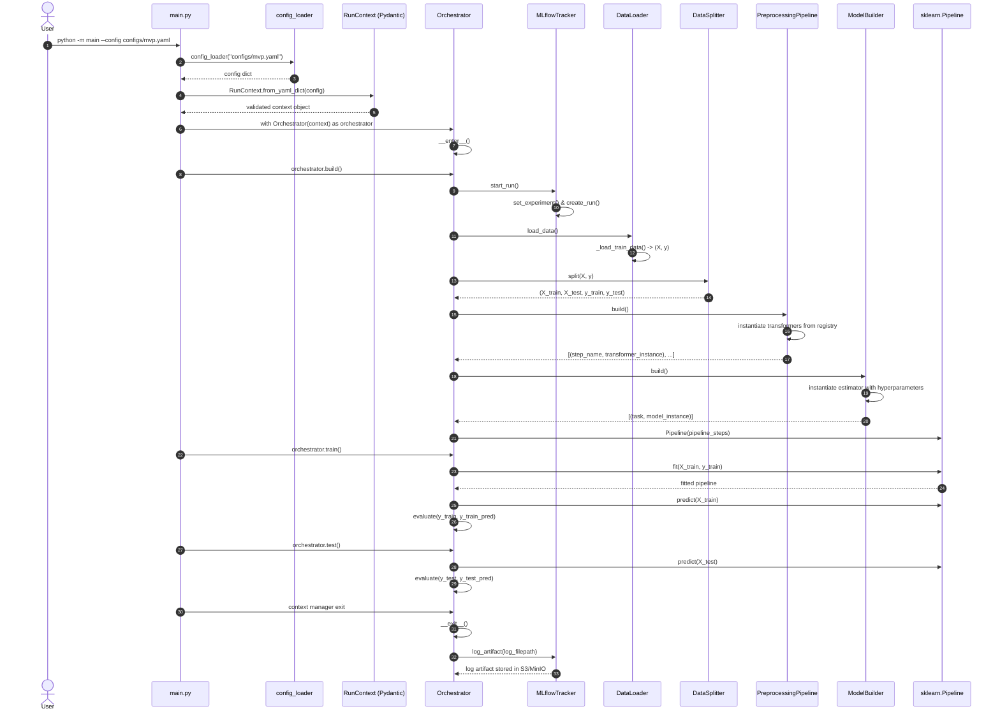

# End-to-End Execution Flow

This document details the complete end-to-end data and control flow when an experiment is executed via `main.py`.

---

## Detailed Sequence Diagram

---

## State Isolation & Leakage Prevention

One of the most critical aspects of this execution sequence is **strict temporal ordering**:

1. **Splitting Occurs Before Fitting**: The raw data is split into $X_{train}, y_{train}$ and $X_{test}, y_{test}$ before any transformer is instantiated or fitted.
2. **Transformers Fit Only on Training Split**: When `pipeline.fit(X_train, y_train)` executes, transformers compute statistics (such as feature means, standard deviations, or category frequencies) strictly using the training observations.
3. **Deterministic Evaluation**: During testing (`pipeline.predict(X_test)`), Scikit-Learn applies only the `.transform()` methods, projecting test samples into the exact feature space learned during training.
