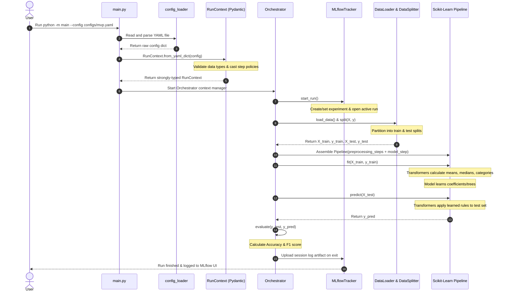

# Execution Flow

This document walks you step-by-step through what happens under the hood when you run:

```bash
uv run python -m main --config configs/mvp.yaml
```

---

## Step-by-Step Sequence



---

## Why Splitting First Matters (Preventing Data Leakage)

**Data Leakage** is one of the most common and costly mistakes in machine learning. It happens when information from your test set accidentally leaks into the training process. 

For example:
- If you compute the **mean of a column** across the *entire* dataset before splitting, the training data now has knowledge of the test set's distribution.
- If you fit a **MinMaxScaler** on all rows, the minimum and maximum values will include test rows.

In `mlflow-experience`, data leakage is impossible by design:
1. **The split happens first**: `DataLoader` loads the data, and `DataSplitter` immediately splits it into training and testing sets.
2. **Transformers only see the training set**: When `pipeline.fit(X_train, y_train)` is called, Scikit-Learn only computes statistics (like means, standard deviations, or category mappings) on $X_{train}$.
3. **The test set is transformed blindly**: When `pipeline.predict(X_test)` runs, Scikit-Learn calls `.transform()` on each step, applying the rules learned during training without recalculating anything.
