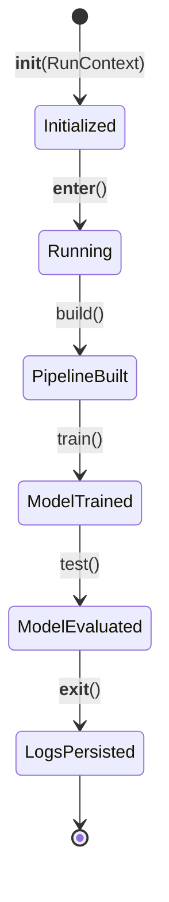

# The Orchestrator Engine

The `Orchestrator` class (`src/orchestrator.py`) is the main coordinator of the whole pipeline.

---

## How It Is Used

In `main.py`, the `Orchestrator` is executed as a Python context manager:

```python
from src.core.context.contexts import RunContext
from src.orchestrator import Orchestrator

# 1. Parse and validate the YAML dictionary into a RunContext
context = RunContext.from_yaml_dict(config)

# 2. Run the pipeline inside the context manager
with Orchestrator(context) as orchestrator:
    orchestrator.build()
    orchestrator.train()
    orchestrator.test()
```

Using `with Orchestrator(...) as orchestrator:` ensures that when the run finishes—or even if an unhandled exception crashes the program—the `__exit__` block runs and uploads the session log to MLflow!

---

## The Lifecycle Stages



### 1. Initialization (`__init__`)
When created, the `Orchestrator` initializes its constituent builders and trackers:
- `self.data_loader`: Prepares data loading logic.
- `self.data_splitter`: Prepares data splitting logic.
- `self.preprocessor`: Prepares the preprocessing transformer factory.
- `self.model_builder`: Prepares the model estimator factory.
- `self.mlflow_tracker`: Connects to the MLflow tracking server.

### 2. Build Stage (`orchestrator.build()`)
This method puts the pieces together:
1. Calls `self.mlflow_tracker.start_run()` to start a new experiment run in MLflow.
2. Calls `self.data_loader.load_data()` to read the data from disk.
3. If no separate test file was provided in the YAML, calls `self.data_splitter.split(X, y)` to partition the data into training and testing sets.
4. Calls `self.preprocessor.build()` to get a list of Scikit-Learn transformer tuples `[(name, transformer), ...]`.
5. Calls `self.model_builder.build()` to get the estimator tuple `[(task_name, model)]`.
6. Combines the transformer steps and model step into `self.pipeline = Pipeline(self.pipeline_steps)`.

### 3. Training Stage (`orchestrator.train()`)
Fits the compiled pipeline:
```python
self.pipeline = self.pipeline.fit(self.data_loader.X, self.data_loader.y)
```
Then predicts on the training data and calls `self.evaluate()` to log in-sample performance metrics.

### 4. Testing Stage (`orchestrator.test()`)
Evaluates the model on unseen test data:
```python
y_pred = self.pipeline.predict(self.data_loader.X_test)
self.evaluate(y_true=self.data_loader.y_test, y_pred=y_pred)
```

### 5. Prediction Stage (`orchestrator.predict(X)`)
Passes new observations $X$ through the fitted pipeline:
```python
def predict(self, X):
    return self.pipeline.predict(X)
```
The data is automatically cleaned, scaled, and encoded using the exact parameters learned during training, and final predictions are returned.

### 6. Exit & Cleanup Stage (`__exit__`)
When exiting the context manager:
1. The active session log file is identified from the logger handlers.
2. The log file is uploaded as an artifact to MLflow:
   ```python
   self.mlflow_tracker.log_artifact(
       console.handlers[1].baseFilename,
       f"logs/{self.mlflow_tracker.run.info.run_name}.log",
   )
   ```
This guarantees you can always trace back any MLflow run to its exact execution log.
