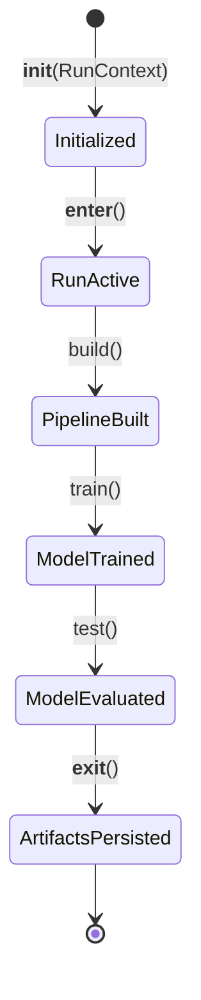

# The Orchestrator Engine

The `Orchestrator` (`src.orchestrator.Orchestrator`) is the central execution conductor of `mlflow-experience`. It manages the lifecycle of an experiment run, coordinating builders, transformers, estimators, and observability trackers.

---

## Context Manager Protocol

The `Orchestrator` implements Python's context manager protocol (`__enter__` and `__exit__`), guaranteeing that runtime resources are cleanly managed and artifacts are saved even if an unexpected exception occurs:

```python
with Orchestrator(context) as orchestrator:
    orchestrator.build()
    orchestrator.train()
    orchestrator.test()
```

### Lifecycle Methods



---

## Method Breakdown

### 1. `__init__(context: RunContext)`

Instantiates the necessary builder and tracking objects using the passed configuration context:

- `self.data_loader = DataLoader(context=context)`
- `self.data_splitter = DataSplitter(context=context)`
- `self.preprocessor = PreprocessingPipeline(context=context)`
- `self.model_builder = ModelBuilder(context=context.model)`
- `self.mlflow_tracker = MLflowTracker(context=context)`

### 2. `build()`

Compiles the end-to-end pipeline:

1. **Initializes MLflow Run**: Calls `self.mlflow_tracker.start_run()`.
2. **Loads Raw Data**: Calls `self.data_loader.load_data()`.
3. **Executes Train-Test Split**: If no dedicated test set is supplied, partitions the dataset via `self.data_splitter.split()`.
4. **Builds Preprocessing Steps**: Calls `self.preprocessor.build()` to get instantiated transformers.
5. **Builds Model Step**: Calls `self.model_builder.build()` to instantiate the target estimator.
6. **Creates Pipeline**: Instantiates `self.pipeline = Pipeline(self.pipeline_steps)`.

### 3. `train()`

Fits the pipeline on the training data:

```python
self.pipeline = self.pipeline.fit(self.data_loader.X, self.data_loader.y)
```

Generates in-sample predictions and computes baseline training metrics.

### 4. `test()`

Evaluates out-of-sample performance on the holdout test set:

```python
y_pred = self.pipeline.predict(self.data_loader.X_test)
self.evaluate(y_true=self.data_loader.y_test, y_pred=y_pred)
```

### 5. `evaluate(y_true, y_pred)`

Computes performance metrics (e.g., Accuracy, F1 Score) and logs them to the console and tracking engine.

### 6. `__exit__(exc_type, exc, tb)`

Automatically finds the active execution log file on disk and uploads it as an artifact to MLflow:

```python
self.mlflow_tracker.log_artifact(
    console.handlers[1].baseFilename,
    f"logs/{self.mlflow_tracker.run.info.run_name}.log",
)
```
