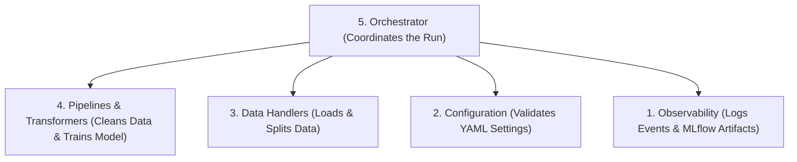

# Architecture Overview

This section explains the design behind `mlflow-experience` so you understand how all the parts fit together.

---

## The Core Idea: Clean Separation of Concerns

In a typical data science project, data loading, cleaning, scaling, feature engineering, modeling, and logging are often mixed together inside a single script or notebook. 

`mlflow-experience` separates these tasks into **5 distinct layers**:

---

## The 5 Layers Explained

### Layer 1: Infrastructure & Observability (The Foundation)
- **Files**: `src/core/trackers/mlflow_tracker.py`, `src/core/logging/logger.py`
- **What it does**: Handles logging and tracking. It connects to MLflow (locally or via Docker), logs your parameters, scores, and models, and writes timestamped logs to `src/core/logs/`.

### Layer 2: Configuration & Validation (The Brain)
- **Files**: `src/core/handler/config/loader.py`, `src/core/context/contexts.py`, `src/core/context/policies.py`
- **What it does**: Reads your YAML file and validates it using **Pydantic v2**. If you have a typo in a strategy name (e.g. `stragegy: meann`), it throws an error immediately before any heavy data loading or model fitting starts.

### Layer 3: Data Management (The I/O Layer)
- **Files**: `src/core/handler/data/loader.py`, `src/core/handler/data/splitter.py`
- **What it does**: Loads your raw files (CSV, Excel, JSON) into Pandas DataFrames. It finds the file path automatically, separates the target column $y$ from features $X$, and performs train/test splitting.

### Layer 4: Transformation & ML Logic (The Engine)
- **Files**: `src/core/pipelines/preprocessing.py`, `src/core/pipelines/transformers.py`, `src/core/pipelines/model_builder.py`
- **What it does**: Creates Scikit-Learn transformers (imputers, scalers, encoders) from your configuration and wraps them into a single `sklearn.pipeline.Pipeline` with the final model estimator.

### Layer 5: Orchestration (The Conductor)
- **Files**: `src/orchestrator.py`
- **What it does**: Coordinates the entire sequence from start to finish. It manages the lifecycle using Python's context manager (`with Orchestrator(context) as orch:`), guaranteeing that execution logs are safely stored even if an error occurs.

---

## Why Use Scikit-Learn Pipelines?

By combining all preprocessing and the model into one `sklearn.pipeline.Pipeline` object:
1. **Preventing Data Leakage**: Transformers only learn statistics (like column means or category frequencies) during `.fit()` on the training split. During `.predict()`, they apply those learned statistics without peeking at the test set.
2. **Atomic Serialization**: The entire preprocessing pipeline and trained model can be saved and deployed together as a single artifact in MLflow.
3. **Reproducibility**: Any future data fed into `pipeline.predict(X_new)` will automatically undergo the exact same cleaning, encoding, and scaling steps.
