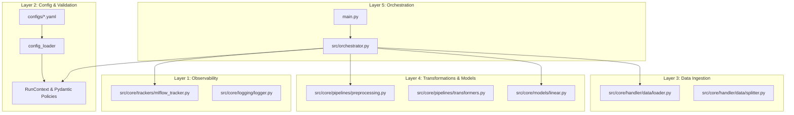

# AI Coding Agent Guide

This document is the operational manual for AI coding agents (such as Antigravity, Claude Code, GitHub Copilot, Cursor, and Windsurf) working in the **`mlflow-experience`** repository.

The root equivalent of this document is maintained at [`AGENTS.md`](file:///d:/GitHub_Clones/mlflow-experience/AGENTS.md).

---

## ⚡ Quick Reference Card

| Item | Standard / Rule |
| :--- | :--- |
| **Python Version** | Python `3.12+` |
| **Package Manager** | **`uv`** (Never use bare `pip` commands) |
| **CLI Entrypoint** | `uv run python -m main --config configs/<name>.yaml` |
| **MLflow Local UI** | `uv run mlflow ui --backend-store-uri sqlite:///mlflow.db` |
| **Documentation** | Material for MkDocs (`uv run mkdocs build --strict`) |
| **Logging** | Always import `console` from `src.core.logging.logger` |
| **DataFrame Preservation** | Always enforce `set_config(transform_output="pandas")` |

---

## 1. Environment & Command Execution

The repository uses **`uv`** exclusively for virtual environments, package management, and script execution.

### Essential Commands

```bash
# 1. Install or sync all dependencies
uv sync

# 2. Run an experiment pipeline with verbose logging
uv run python -m main --config configs/mvp.yaml --logging-level DEBUG

# 3. Run XGBoost experiment pipeline
uv run python -m main --config configs/mvp_xgboost.yaml

# 4. Verify documentation build (strict mode: zero broken links allowed)
uv run mkdocs build --strict

# 5. Serve documentation locally
uv run mkdocs serve

# 6. Run linter
uv run flake8
```

> [!WARNING]
> Do NOT execute `pip install <package>`. If a new dependency is required, add it to `requirements.txt` or `pyproject.toml` and run `uv pip install -r requirements.txt`.

---

## 2. Architectural Blueprint

`mlflow-experience` is organized in **5 decoupled layers**:



### Where Code Lives

```text
src/
├── orchestrator.py             # Orchestrator context manager (__enter__ / __exit__)
├── core/
│   ├── constants/
│   │   ├── constants.py        # FILE_TYPES and strategy type literals
│   │   └── registry.py         # PreprocessingRegistry, ModelType, DATA_READER_FUNCTIONS
│   ├── context/
│   │   ├── contexts.py         # RunContext, ProjectContext, MlFlowContext, DataContext
│   │   └── policies.py         # Pydantic policies (RenamePolicy, ScalingPolicy, etc.)
│   ├── errors/                 # Custom error classes (ConfigurationError, etc.)
│   ├── handler/
│   │   ├── config/loader.py    # YAML file reader and environment interpolator
│   │   └── data/               # DataLoader and DataSplitter classes
│   ├── logging/logger.py       # Dual-logger: Rich console output + rotating file
│   ├── models/linear.py        # ModelBuilder and estimator initialization
│   ├── pipelines/
│   │   ├── preprocessing.py    # PreprocessingPipeline dynamic assembler
│   │   └── transformers.py     # Custom Scikit-Learn transformers
│   └── trackers/
│       └── mlflow_tracker.py   # MLflow experiment lifecycle manager
└── utils/path_resolver.py      # Robust path resolution (handles working dir vs root)
```

---

## 3. Extending the Codebase: Recipes for Agents

### Recipe A: Adding a New Preprocessing Transformer

To add a new transformer (e.g. `ClipOutliersTransformer`):

1. **Implement the Transformer** in `src/core/pipelines/transformers.py`:
   - Inherit from `BaseEstimator` and `TransformerMixin`.
   - Learn parameters **strictly in `fit(X, y)`**. Never compute statistics in `__init__` or `transform`.
   - Apply transformations in `transform(X)`. Ensure output is a DataFrame (`X.copy()`).

2. **Define Pydantic Policy** in `src/core/context/policies.py`:
   - Create a typed config (e.g. `ClipOutliersPolicy(BaseModel)`).

3. **Register the Step** in `src/core/constants/registry.py`:
   - Add enum member to `PreprocessingRegistry`:
     ```python
     clip_outliers = "clip_outliers"
     ```
   - Map `policy_class` and `transformer_class` in their respective properties.

4. **Instantiate** in `src/core/pipelines/preprocessing.py`:
   - Ensure `_instantiate_transformer()` extracts the policy parameters and initializes the transformer instance.

---

### Recipe B: Adding a New Model Estimator

To add a new model (e.g. `RandomForestClassifier` or `LightGBM`):

1. **Update Enum & Mapping** in `src/core/constants/registry.py`:
   - Add to `ModelType`:
     ```python
     random_forest = "random_forest"
     ```
   - In `ModelType.model_class` property:
     ```python
     ModelType.random_forest: RandomForestClassifier
     ```

2. **Instantiate in Model Builder** (`src/core/models/linear.py`):
   - Unpack hyperparameters safely: `model_class(**self.hyperparameters)`.

---

### Recipe C: Adding a New Data File Format

To support a new format (e.g. `parquet`):

1. Add literal to `FILE_TYPES` in `src/core/constants/constants.py`:
   ```python
   FILE_TYPES = Literal["csv", "excel", "json", "parquet"]
   ```
2. Register reader in `DATA_READER_FUNCTIONS` in `src/core/constants/registry.py`:
   ```python
   "parquet": pd.read_parquet,
   ```

---

## 4. Invariants & Rules You Must Never Break

> [!IMPORTANT]
> 1. **DataFrames Stay DataFrames**:
>    Never drop column names into a raw NumPy array during preprocessing unless explicitly requested. Always keep `set_config(transform_output="pandas")` active.
> 
> 2. **Zero Data Leakage**:
>    Never compute global parameters across train and test sets combined. Imputers, scalers, and encoders must only fit on `X_train`.
> 
> 3. **Dual Logging Discipline**:
>    Never use bare `print()` calls in `src/`. Always use:
>    ```python
>    from src.core.logging.logger import console
>    console.info("Descriptive log message")
>    console.debug("Low-level debugging info")
>    console.error("Failure reason")
>    ```
> 
> 4. **Sequential Execution Awareness**:
>    Preprocessing steps in YAML execute sequentially. If Step 1 renames column `old_col` &rarr; `new_col`, Step 2 (scaling/encoding) must refer to `new_col`.
> 
> 5. **Pydantic Validation Guard**:
>    All configuration values must be validated by Pydantic before any data processing starts. Never access unvalidated raw dictionary keys directly inside pipelines.
> 
> 6. **Path Resolution**:
>    Do not rely on `os.getcwd()` for relative file paths. Always use `resolve_path()` from `src.utils.path_resolver`.

---

## 5. Pre-Completion Verification Checklist

Before reporting any coding task as finished, run these verification steps in order:

- [ ] **Run Baseline Pipeline**:
  ```bash
  uv run python -m main --config configs/mvp.yaml
  ```
  *(Must complete with exit code 0 and log metrics to MLflow).*
- [ ] **Run XGBoost Pipeline**:
  ```bash
  uv run python -m main --config configs/mvp_xgboost.yaml
  ```
  *(Must complete with exit code 0).*
- [ ] **Verify Documentation**:
  ```bash
  uv run mkdocs build --strict
  ```
  *(Must build in strict mode with 0 errors and 0 warnings).*
- [ ] **Code Hygiene**:
  Ensure no temporary debug files, scratch files, or unwanted `.db` files are left uncommitted or unignored.

---

## 6. Common Pitfalls & Solutions

| Symptom | Cause | Fix |
| :--- | :--- | :--- |
| `KeyError: 'Age'` in scaling step | A prior `rename` step changed `'Age'` to `'age'`. | Check pipeline order in YAML; use the renamed column name in subsequent steps. |
| `MLflow connection refused (localhost:5000)` | Docker MLflow server is not running. | Set `tracking_uri: sqlite:///mlflow.db` in the YAML file for offline local tracking. |
| Transformer returns NumPy array | Transformer did not respect Scikit-Learn pandas output. | Set `set_config(transform_output="pandas")` and return `X.copy()`. |
| `ValueError: Input contains NaN` | Scaler or encoder was placed before missing value imputer. | Place `missing` imputer before `scaling` and `encoding` in the YAML list. |
| Broken link in docs during build | File was created but not registered in `mkdocs.yml` navigation. | Add the path to `nav` in `mkdocs.yml`. |
