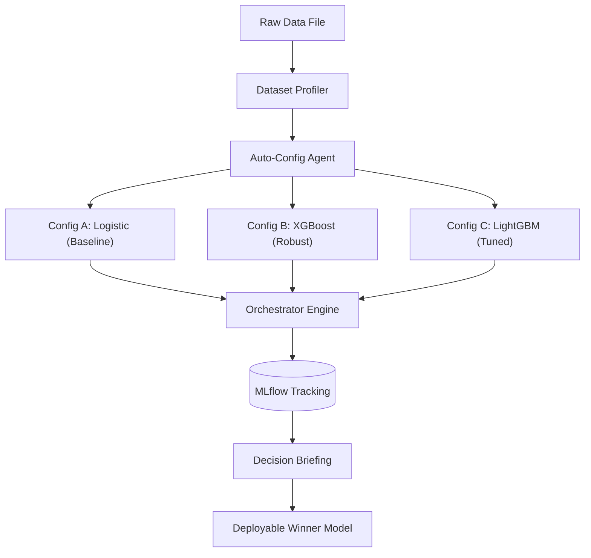
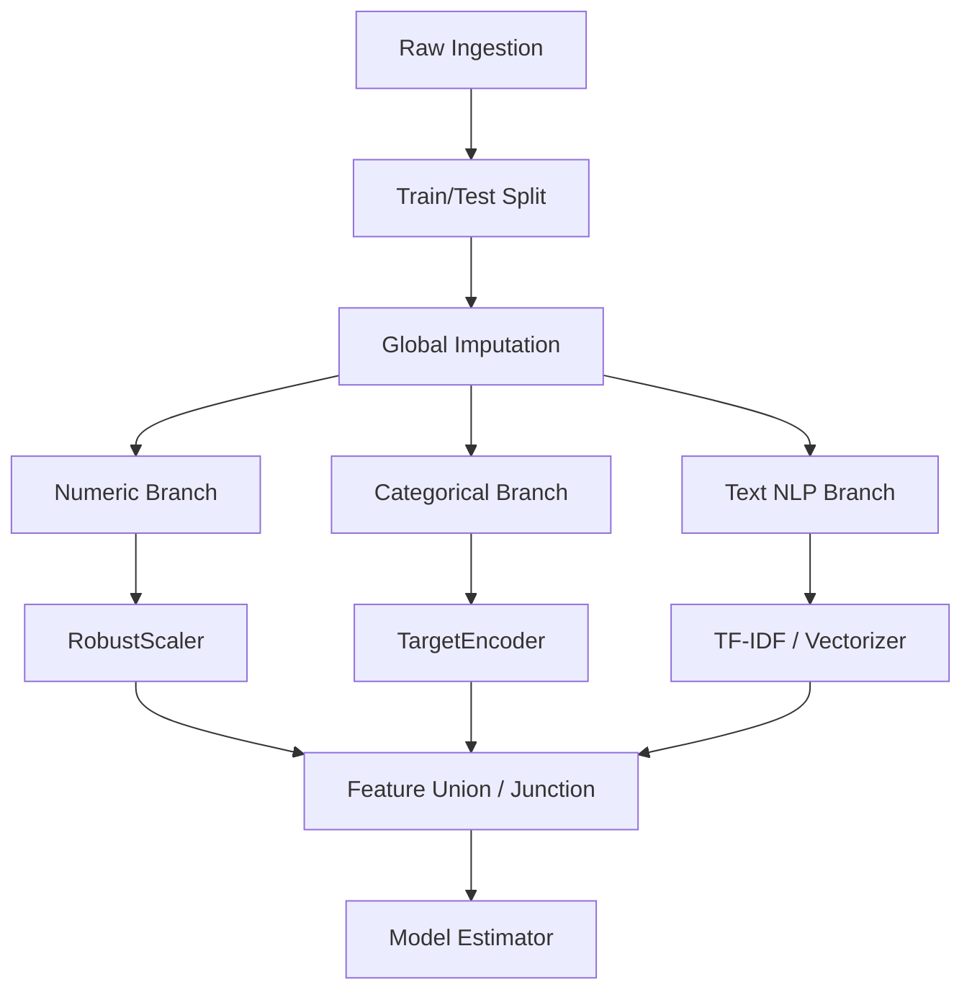

# Future Enhancements & Architectural Scenarios

This document outlines the strategic roadmap, planned architectural evolutions, and feature scenarios for **`mlflow-experience`**. It bridges the initial prototype and MVP tasks into an enterprise-ready, declarative MLOps platform.

---

## 🎯 Vision Statement

`mlflow-experience` aims to be the **most intuitive declarative MLOps framework**:
- Developers and data scientists describe *what* they want (data, cleaning, transformations, models, metrics) in structured YAML.
- The engine handles *how* it executes (leakage-free splitting, dependency resolution, execution telemetry, model tracking, and production export).
- Autonomous AI agents can navigate the configuration space to iterate on experiments without human intervention.

---

## 📊 Future Capabilities Matrix

| Scenario | Focus Area | Impact | Complexity | Target Layer |
| :--- | :--- | :---: | :---: | :--- |
| [**1. Autonomous Auto-Config AI Agent**](#scenario-1-autonomous-auto-config-ai-agent) | LLM Automation | 🔥 High | Medium | Orchestration / CLI |
| [**2. DAG Pipeline & Branching Engine**](#scenario-2-dag-pipeline-and-branching-engine) | Preprocessing | 🔥 High | High | Preprocessing Engine |
| [**3. Cloud Lakehouse & DuckDB Ingestion**](#scenario-3-cloud-storage-lakehouse-and-modern-formats) | Data Ingestion | Medium | Medium | Data Ingestion Layer |
| [**4. Declarative Hyperparameter Tuning (HPO)**](#scenario-4-declarative-hyperparameter-tuning-with-optuna) | Model Training | 🔥 High | Medium | Training Engine |
| [**5. Production Serving & ONNX Export**](#scenario-5-production-serving-and-export-engine) | Deployment | 🔥 High | High | Serving Layer |
| [**6. Data Drift & Automated Retraining**](#scenario-6-data-drift-and-continuous-monitoring) | Monitoring | Medium | Medium | Observability |
| [**7. MLflow Tracing & Step Telemetry**](#scenario-7-mlflow-tracing-and-step-level-telemetry) | Observability | Medium | Low | Tracking Engine |
| [**8. Visual Web Pipeline Builder UI**](#scenario-8-visual-pipeline-builder-ui) | Developer UX | Medium | High | UI / Tooling |

---

## Scenario 1: Autonomous Auto-Config AI Agent

### Problem Statement
Currently, humans must inspect data distributions manually, choose imputation strategies, identify high-cardinality features, write YAML files, and run commands.

### Proposed Solution
Introduce an AI agent mode via `uv run python -m agent` that:
1. Profiles a raw dataset (column types, null ratios, cardinality, skewness).
2. Generates multiple candidate YAML configuration strategies:
   - Baseline linear model with standard scaling.
   - Robust tree model with target/ordinal encoding.
   - Complex model with interaction features.
3. Automatically launches concurrent experiments, analyzes MLflow metrics, and returns a markdown comparison report with the winning run.



### Proposed CLI Interface
```bash
uv run python -m agent \
  --data data/raw/customer_churn.csv \
  --target Churn \
  --goal "Maximize F1 score while prioritizing model interpretability" \
  --max-trials 5
```

---

## Scenario 2: DAG Pipeline and Branching Engine

### Problem Statement
The current preprocessing engine is strictly linear:
$$\text{Step 1} \to \text{Step 2} \to \text{Step 3}$$
Real-world pipelines require **branching and multi-modal handling**:
- Numeric features need median imputation followed by robust scaling.
- Text features need tokenization and TF-IDF / vector embeddings.
- Categorical features need target encoding or one-hot encoding.
- All branches must be combined prior to estimator training.

### Proposed Architecture



### Proposed YAML Schema
```yaml
preprocessing:
  execution_mode: dag # "linear" | "dag"
  nodes:
    - id: impute_step
      type: missing
      params: { ... }

    - id: scale_numerics
      type: scaling
      depends_on: [impute_step]
      params: { ... }

    - id: encode_categoricals
      type: encoding
      depends_on: [impute_step]
      params: { ... }

    - id: merge_features
      type: feature_union
      depends_on: [scale_numerics, encode_categoricals]
```

---

## Scenario 3: Cloud Storage, Lakehouse, and Modern Formats

### Problem Statement
Production datasets reside in cloud buckets (AWS S3, Google Cloud Storage, Azure Blob Storage) and columnar lakehouses, not local CSV files. Loading 50GB CSV files into Pandas causes Out-Of-Memory (OOM) crashes.

### Proposed Solution
1. **Cloud Connectors**: Direct streaming/download from `s3://`, `gs://`, and `abfss://`.
2. **Columnar Ingestion**: Native support for Apache Parquet and Apache Arrow with lazy schema evaluation.
3. **DuckDB In-Memory SQL Ingestion**: Filter and aggregate multi-gigabyte files before loading into memory.

### Proposed YAML Schema
```yaml
dataset:
  dataset_name: enterprise_churn_v2
  train:
    type: parquet
    path: s3://mlops-prod-data/telecom/churn_2026_q1.parquet
    storage_options:
      key: env:AWS_ACCESS_KEY_ID
      secret: env:AWS_SECRET_ACCESS_KEY
    sql_query: >
      SELECT customer_id, age, tenure, monthly_charges, churn
      FROM read_parquet('s3://...')
      WHERE status = 'ACTIVE' AND age >= 18
    id_column: customer_id
    target_column: churn
```

---

## Scenario 4: Declarative Hyperparameter Tuning with Optuna

### Problem Statement
Currently, users must manually edit YAML hyperparameters for each experiment run.

### Proposed Solution
Integrate **Optuna** to perform Bayesian Optimization (Tree-structured Parzen Estimator) directly driven by YAML:

### Proposed YAML Schema
```yaml
tuning:
  enabled: true
  framework: optuna
  n_trials: 50
  timeout_seconds: 1800
  metric: f1
  direction: maximize

  search_space:
    model.hyperparameters.learning_rate:
      type: float
      low: 0.001
      high: 0.3
      log: true
    model.hyperparameters.max_depth:
      type: int
      low: 3
      high: 12
    model.hyperparameters.n_estimators:
      type: categorical
      choices: [100, 200, 500]
```

### MLflow Integration
Each Optuna trial automatically logs as a **nested child run** inside MLflow with parameter coordinates, trial duration, and optimization history contour plots.

---

## Scenario 5: Production Serving and Export Engine

### Problem Statement
After training a winning model, deploying it into an operational service requires manual packaging and glue code.

### Proposed Solution
Add an automated export and serving CLI to turn any trained run into a high-throughput microservice.

### Features
1. **ONNX Export**: Convert Scikit-Learn / XGBoost pipelines into an optimized ONNX graph for ultra-low latency inference (`< 5ms`).
2. **Instant REST API**: Spin up a FastAPI microservice with automatic Pydantic validation derived from the dataset schema.
3. **Container Generator**: Generate a standalone, production-hardened Dockerfile packaging the frozen pipeline artifact.

```bash
# Serve winning run directly
uv run python -m serve --run-id 4a7c819d2e --port 8080

# Export to ONNX runtime
uv run python -m export --run-id 4a7c819d2e --format onnx --output models/churn_v1.onnx

# Build container
uv run python -m containerize --run-id 4a7c819d2e --tag churn-predictor:v1
```

---

## Scenario 6: Data Drift and Continuous Monitoring

### Problem Statement
Models degrade silently over time as real-world distributions shift away from baseline training distributions.

### Proposed Solution
Integrate **Evidently AI** or **Great Expectations** directly into the evaluation layer:
1. **Data Drift Detection**: Compare production scoring batches against the training baseline using Kolmogorov-Smirnov (KS) tests and Population Stability Index (PSI).
2. **Concept Drift**: Track rolling precision/recall when ground-truth labels arrive.
3. **Automated Alerting**: Push drift reports directly into MLflow Artifacts and trigger webhook alerts when drift score exceeds predefined thresholds.

```yaml
monitoring:
  drift_detection:
    enabled: true
    confidence_level: 0.95
    alert_threshold_psi: 0.25
    report_format: html
```

---

## Scenario 7: MLflow Tracing and Step-Level Telemetry

### Problem Statement
Currently, MLflow logs pipeline-level summary metrics (accuracy, F1, latency), but gives no visibility into which individual transformer is slow or causing memory spikes.

### Proposed Solution
Adopt **MLflow Tracing** and a `@track_step` execution wrapper:
- Log execution duration per step in milliseconds.
- Log memory delta (RAM before vs after transformation).
- Log feature dimensional changes (e.g., input: 12 features &rarr; output: 34 features after one-hot encoding).
- Generate a waterfall visualization in the MLflow UI.

```text
[Pipeline Execution Waterfall]
├── Ingestion & Split       [  120ms | 10,000 rows x 15 cols ]
├── CleaningTransformer     [   15ms | 10,000 rows x 15 cols ]
├── MissingValueTransformer [   45ms | 10,000 rows x 15 cols ]
├── EncodingTransformer     [   85ms | 10,000 rows x 38 cols ]
├── ScalingTransformer      [   22ms | 10,000 rows x 38 cols ]
└── XGBoost Estimator       [ 1,450ms | Train accuracy: 0.942 ]
```

---

## Scenario 8: Visual Pipeline Builder UI

### Problem Statement
Writing YAML manually can lead to indentation mistakes or invalid column references.

### Proposed Solution
A browser-based visual studio (built with Streamlit or Vite + React):
1. **Interactive Node Canvas**: Drag-and-drop cleaning, encoding, scaling, and estimator blocks.
2. **Live Schema Preview**: Upload a sample CSV, inspect inferred column types, and preview transformations live.
3. **YAML Synchronizer**: Real-time two-way synchronization between visual canvas and the YAML editor.
4. **One-Click Run**: Trigger pipeline executions with live progress streaming.

---

## 🛠️ Technical Refactoring Backlog

To support the above scenarios cleanly, the following core refactors are planned:

| Area | Current Technical Debt | Target Refactor |
| :--- | :--- | :--- |
| **Context Coupling** | Components hold full `RunContext` references | Implement clean dependency injection / passing only required sub-contexts. |
| **Transformer Signatures** | Hardcoded checks in `_instantiate_transformer` | Formalize a standard `BaseTransformerPolicy` and protocol interface. |
| **Error Handling** | Generic runtime exceptions / silent step skips | Introduce explicit domain errors (`DataValidationError`, `TransformationError`). |
| **Type Hints** | Untyped `params` dictionaries | Pydantic V2 discriminated unions for all step parameter types. |
| **Multi-Target Support** | Binary classification focus | Support multi-class classification and multi-target regression. |

---

## 🗺️ Phased Implementation Roadmap

```mermaid
flowchart LR
    subgraph P1["Phase 1 (Q2 2026)"]
        direction TB
        A1["DAG Pipeline Engine"]
        A2["Cloud Ingestion (S3/Parquet)"]
        A3["Step-Level MLflow Traces"]
    end

    subgraph P2["Phase 2 (Q3 2026)"]
        direction TB
        B1["Optuna Hyperparameter Tuning"]
        B2["Automated ONNX & FastAPI Export"]
        B3["Data Drift Detection"]
    end

    subgraph P3["Phase 3 (Q4 2026)"]
        direction TB
        C1["Autonomous Auto-Config AI Agent"]
        C2["Visual Web Builder UI"]
        C3["Enterprise Multi-Tenant Registry"]
    end

    P1 --> P2 --> P3
```


