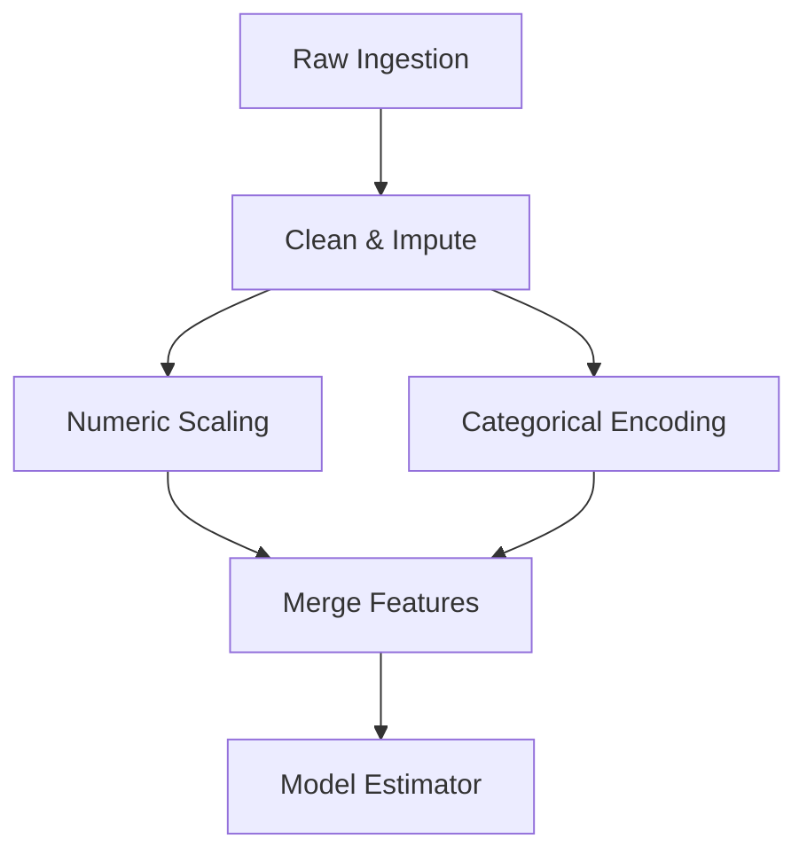

# Architectural Roadmap

This document outlines upcoming architectural enhancements planned for `mlflow-experience`.

!!! tip "Full Future Capabilities Matrix"
    For an in-depth exploration of 8 future scenarios (Autonomous Agents, Cloud Lakehouses, Optuna HPO, Production Serving, and Monitoring), read the full [Future Enhancements & Scenarios](future-enhancements.md) guide.

---

## 1. Directed Acyclic Graph (DAG) Pipeline Engine

### Current Design: Linear Pipeline
Currently, the pipeline executes sequentially:
$$\text{Step 1} \to \text{Step 2} \to \text{Step 3} \to \text{Step 4}$$

### Planned Design: DAG Execution
Real-world feature engineering often requires branching (e.g. processing text features and numeric features independently, then merging them before the model):



**Key Improvements:**
- Explicit `depends_on` definitions in YAML for each node.
- Automatic dependency ordering via **Topological Sorting**.
- Cycle detection to prevent infinite loops.

---

## 2. Nested MLflow Runs & `@track_node` Decorator

### Current Design
The entire pipeline runs inside one parent MLflow run.

### Planned Design
Each step in the pipeline automatically creates a nested child run in MLflow:

```text
customer_churn_pipeline (Parent Run)
 ├── rename_columns (Child Run)
 ├── handle_missing (Child Run)
 ├── encode_features (Child Run)
 ├── scale_features (Child Run)
 └── model_fit (Child Run)
```

By wrapping transformer execution in a `@track_node` decorator:
- Each step automatically logs input shape, output shape, and execution time in milliseconds.
- Pinpoints the exact step where an error or data anomaly occurred.

---

## 3. Configurable Feature Engineering Factories

Formalize `src/core/pipelines/features.py` into a modular feature generator:
- **Aggregations**: Group-by calculations (e.g. average monthly spend per user).
- **Interactions**: Automated ratio, difference, and product features (e.g. `total_spend / tenure`).
- **Temporal Transformations**: Sine/Cosine cyclic encoding for dates, day-of-week extraction, and rolling metrics.

---

## 4. Visual Pipeline Builder UI

An optional browser-based UI to visually build, edit, and export YAML configurations without manual typing.
