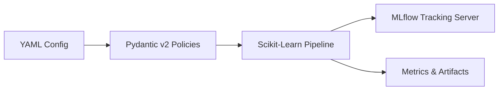

# Welcome to mlflow-experience

> **A declarative, configuration-driven MLOps pipeline platform built on Scikit-Learn, Pydantic, and MLflow.**

`mlflow-experience` provides an enterprise-ready framework for defining, running, reproducing, and tracking machine learning pipelines entirely through human-readable **YAML configuration files**.



---

## Core Capabilities

- **Zero-Code Experimentation**: Define full pipelines—from ingestion and missing value imputation to categorical encoding, scaling, model training, and evaluation—simply by modifying a YAML file.
- **Strict Separation of Concerns**: Each phase of the machine learning lifecycle is governed by an independent component (`DataLoader`, `DataSplitter`, `PreprocessingPipeline`, `ModelBuilder`, `Orchestrator`, `MLflowTracker`).
- **Data Leakage Prevention**: Transformers learn parameters (means, medians, scales, categories) strictly during `fit()` on training splits and apply them without modification on testing data.
- **Full DataFrame Preservation**: Integrates Scikit-Learn's `set_config(transform_output="pandas")`, ensuring that DataFrames with column names and types flow seamlessly between transformers.
- **Centralized Observability**: Automatic logging of parameters, metrics, model binaries, and execution log files into a local or remote MLflow tracking server backed by PostgreSQL and MinIO S3 storage.

---

## Quick Navigation

<div class="grid cards" markdown>

- :material-rocket-launch: **[Getting Started](getting-started/quickstart.md)**

    ***

    Install the framework, spin up the Docker tracking stack, and launch your first model experiment in minutes.

- :material-sitemap: **[Architecture Blueprint](architecture/overview.md)**

    ***

    Explore the 5-layer design, the Command/Orchestrator pattern, and the Factory pattern powering the platform.

- :material-cog: **[YAML Configuration Guide](configuration/yaml-schema.md)**

    ***

    Detailed specification of configuration keys, types, and column-level preprocessing policies.

- :material-chart-timeline: **[Observability & MLflow](observability/mlflow.md)**

    ***

    Learn how runs, parameters, metrics, and session logs are automatically recorded to MLflow.

</div>

---

## High-Level Execution

Running an experiment is as simple as executing:

```bash
python -m main --config configs/mvp.yaml --logging-level DEBUG
```

This single command triggers schema validation, data loading, train/test splitting, dynamic pipeline construction, model fitting, metric calculation, and artifact logging.
