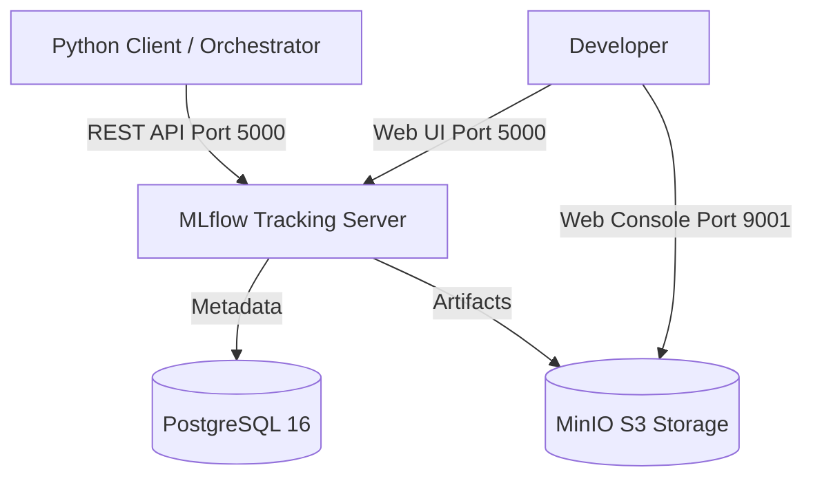

# Docker Compose Infrastructure

The repository provides a complete, containerized MLflow tracking environment in `compose.yaml`.

---

## 1. Stack Overview



### Components
1. **PostgreSQL 16**: Relational backend store for experiment entities, run IDs, metric series, parameters, and tags. Initialized with `init-db.sql`.
2. **MinIO Object Storage**: High-performance S3-compatible storage for artifacts (trained models, pipeline pickles, session logs).
3. **MLflow Tracking Server**: Centralized server coordinating metadata and artifact storage.

---

## 2. Environment Configuration (`.env`)

```env
# PostgreSQL
POSTGRES_DB=mlflowdb
POSTGRES_USER=mlflow
POSTGRES_PASSWORD=mlflowpass

# MinIO
MINIO_ROOT_USER=minioadmin
MINIO_ROOT_PASSWORD=minioadminpass

# MLflow Server
MLFLOW_HOST=0.0.0.0
MLFLOW_PORT=5000
```

---

## 3. Starting and Stopping the Stack

=== "Start Stack (Detached)"
    ```bash
    docker compose up -d
    ```

=== "Check Status"
    ```bash
    docker compose ps
    ```

=== "Stop Stack"
    ```bash
    docker compose down
    ```
