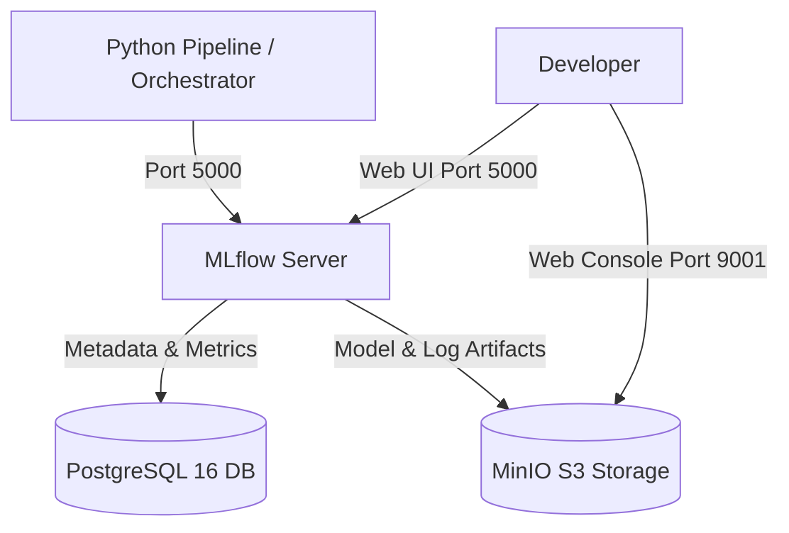

# Docker Compose Infrastructure

`mlflow-experience` provides a production-grade MLflow tracking server setup in `compose.yaml`.

---

## 1. What Services Run in Docker?



1. **MLflow Server (`mlflow`)**:
   - Web UI & REST API running on port `5000`.
   - Coordinates experiment runs, parameters, metrics, and models.
2. **PostgreSQL Database (`postgres`)**:
   - Stores all relational metadata (experiment names, run IDs, tags, parameters, and metric histories).
   - Initialized using `init-db.sql`.
3. **MinIO Object Storage (`minio`)**:
   - S3-compatible object storage for artifacts (e.g. trained model pickles, execution log files).
   - S3 API on port `9000`, Web Console on port `9001`.

---

## 2. Environment Settings (`.env`)

Service credentials and ports are managed in `.env`:

```env
# PostgreSQL
POSTGRES_DB=mlflowdb
POSTGRES_USER=mlflow
POSTGRES_PASSWORD=mlflowpass

# MinIO
MINIO_ROOT_USER=minioadmin
MINIO_ROOT_PASSWORD=minioadminpass

# MLflow Server
MLFLOW_HOST=0.0.0.0
MLFLOW_PORT=5000
```

---

## 3. Starting the Services

### Start in the background:
```bash
docker compose up -d
```

### Check status:
```bash
docker compose ps
```

### Stop the services:
```bash
docker compose down
```

---

## 4. Web Dashboards

- **MLflow Tracking UI**: [http://localhost:5000](http://localhost:5000)
- **MinIO Storage Console**: [http://localhost:9001](http://localhost:9001)
  - Username: `minioadmin`
  - Password: `minioadminpass`
  - Bucket name: `mlflow`

---

## 5. Don't Have Docker?

If you don't have Docker installed or running on your system, you don't need it! You can start a local MLflow server directly with `uv`:

```bash
uv run mlflow server --backend-store-uri sqlite:///mlflow.db --default-artifact-root ./mlruns --port 5000
```
